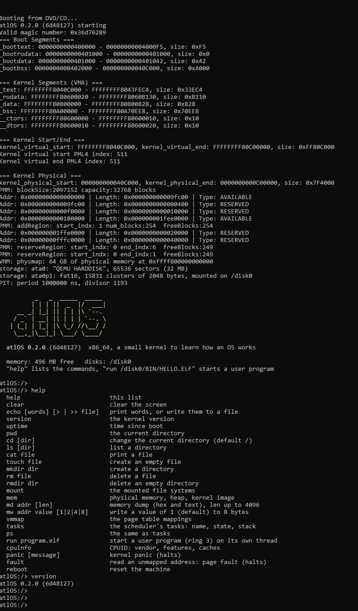

# atlOS


[](https://github.com/oguzhankynk/atlOS/actions/workflows/ci.yml)
[](https://github.com/oguzhankynk/atlOS/releases)

atlOS is an experimental x86_64 operating system written in C++17 for learning
and research. It boots with GRUB (multiboot2) into a higher half kernel and is
small enough to read end to end.

## Status

Working:

- 64-bit higher half kernel (loaded at 4 MB, mapped at `0xFFFFFFFF80000000` + physical), booted by GRUB2
- GDT with a TSS (double fault stack), IDT, decoded exception reports with a backtrace, 8259 PIC, PIT (1 ms tick)
- Physical memory manager (2 MB blocks + 4 KB frames for page tables)
- Virtual memory with 2 MB pages, a physmap of all physical memory, and separate address spaces sharing the kernel half
- Kernel heap (`kmalloc`/`kfree`, based on liballoc 1.1)
- Cooperative round robin scheduler: threads, `yield`, `sleep`, `block`/`unblock`
- Synchronization: atomics, wait queues, semaphores, mutexes, condition variables
- PS/2 keyboard (US layout) and serial input
- A kernel shell (keyboard or serial terminal) that reaches everything: files, `md`/`mw` memory dump and write, `vmmap`, `pt`, `tasks`, `run`, `cr`, `rdmsr`/`wrmsr`, `in`/`out`, `gdt`/`idt`, `irq`, `int`, `disk read`, `lspci`, ... (`help` lists them by group)
- User programs: static ELF64 files from the disk, run in ring 3 in their own address space, `int 0x80` system calls (`read`/`write` on the keyboard, the screen and files, `open`/`close`, `sleep`, `yield`, `getpid`, `uptime`, `exit`); a fault ends only the program. Writing one: [user/README.md](user/README.md)
- PCI and PCIe: every bus scanned through the configuration ports, `lspci` with the BARs and capabilities
- ATA disks (PIO), MBR partitions, FAT16 (read and write, 8.3 names) and a VFS with mount points (`/disk0/...`)
- Serial (COM1) and VGA text output, a small freestanding libc (`libk`)
- In-kernel self tests run headless in QEMU

The CPUID helpers are built and tested but not called at
boot. The shell runs in the kernel; user programs reach it through nine system calls.
atlOS runs on a single CPU, scheduling is cooperative.

## Quick start

You need an `x86_64-elf` GCC cross compiler on `PATH` (`scripts/build-toolchain.sh`
builds one), CMake 3.22+, Ninja, `grub-mkrescue` (with xorriso) and QEMU. See
[docs/building.md](docs/building.md). Or boot a ready made ISO from the
[releases](https://github.com/oguzhankynk/atlOS/releases).

```sh
scripts/build.sh            # libc, kernel and build/default/atlOS.iso
scripts/build.sh run        # boot in QEMU, the shell on the terminal
scripts/build.sh selftest   # build and run the self tests
scripts/build.sh crashtest  # a kernel that faults on purpose: check the report
scripts/build.sh shelltest  # drive the shell over the serial port
```

The same with CMake directly:

```sh
cmake --preset default
cmake --build --preset default --target run
```

`scripts/build.sh run` shows the boot messages, then the shell, on the
terminal (see the [screenshot](#screenshot) below).

## Source layout

```
kernel/
  arch/x86_64/   boot, crt, cpu (context switch, CPUID), gdt, idt (+ISR stubs), io ports, mmu
  core/          kernel entry (main.cpp), panic, logger, banner
  cxx/           C++ runtime support (global constructors, new/delete)
  mm/            pmm, vmm, heap (liballoc)
  sched/         scheduler, threads
  shell/         the kernel shell: line editor, parser, commands
  proc/          user programs: ELF loading, ring 3, system calls
  sync/          atomic, interrupt guard, wait queue, semaphore, mutex, condition variable, spinlock
  drivers/       pic, pit, serial, vga console, keyboard, disk/ (block devices, ATA, MBR), pci/
  fs/            file system interface, fat16, vfs, mounting the disks
  firmware/      bios, smbios
  lib/           small header-only helpers
  tests/         in-kernel self tests
libc/            freestanding C library (libk) used by the kernel
cmake/           cross toolchain file
user/            user programs (ring 3) for the test disk, see user/README.md
scripts/         build.sh, run-selftest.sh, run-crashtest.sh, symbolize.sh, make-disk-image.sh, check-test-disk.sh
tools/           grub.cfg, files of the test disk
docs/            documentation
```

Headers live next to their sources; includes are relative to `kernel/`, for
example `#include <mm/vmm.hpp>`.

The subsystem directories have a README that explains the concept, the usual ways to design it, what atlOS chose and why,
with diagrams and references:
[mm](kernel/mm/README.md), [sched](kernel/sched/README.md),
[drivers](kernel/drivers/README.md), [interrupts](kernel/arch/x86_64/idt/README.md).

## Documentation

- [Building and running](docs/building.md)
- [Architecture and boot flow](docs/architecture.md)
- [Memory management](docs/memory.md)
- [Scheduler and threads](docs/scheduler.md)
- [Self tests](docs/testing.md)
- [Code style and design](docs/style.md)
- [Versioning and releases](docs/releasing.md), [changelog](CHANGELOG.md)

API documentation can be generated with Doxygen: `scripts/build.sh docs`
(output in `build/docs/html`).

## License

MIT, see [LICENSE](LICENSE). Third party code and its licenses:
[THIRD_PARTY.md](THIRD_PARTY.md).

## Screenshot


