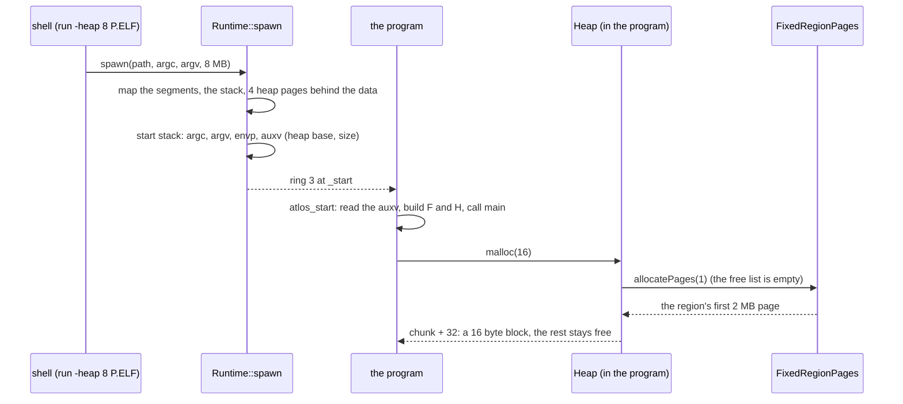

# The heap (`common/heap/`)

`Memory::Heap` hands out blocks of any size and takes them back: the
kernel's `kmalloc` and `new`, and a user program's `malloc`. It is the same
code in both, built twice; only the `PageSource` it gets its pages from
differs.

```
kmalloc / new / delete          kernel/mm/heap.cpp            malloc / free           user/lib/malloc.cpp
          │                                                         │
          ▼                                                         ▼
       Memory::Heap   (heap.cpp: a free list, first fit, neighbours merged on free)
          │                                                         │
          ▼                                                         ▼
AddressSpacePages: 2 MB pages of                         FixedRegionPages: the pages of the region
the kernel address space (vmm.cpp)                       the kernel mapped before the program started
```

## What is it for?

Most of what a program keeps has a size that is only known while it runs: a
line typed on the keyboard, a list that grows, a file read into memory, a
`new Thread(...)`. Globals have a size fixed when the program is compiled,
and the stack frees everything when the function returns. A **heap** is
memory the program asks for and gives back in any order, in any size.

The memory manager underneath works in **pages** (2 MB in atlOS). Asking it
for 24 bytes would waste almost all of a page. So allocating is split in
two:

1. **Coarse**: someone hands the heap whole pages (the kernel's VMM, or the
   kernel mapping a region for a program).
2. **Fine**: the heap cuts the pages into blocks, remembers which are free,
   and reuses them.

This directory is the second part. The questions it has to answer: where is
a free block large enough, what to do with the rest of a block that is too
large, and how to keep many small free pieces from piling up
(**fragmentation**).

## How could it be designed?

| Approach | How | Plus | Minus | Used by |
|---|---|---|---|---|
| Bump | a pointer moves forward, `free` does nothing | 10 lines, fastest | memory is never reused | early boot, arenas |
| **Free list** | every block has a header (its size); free blocks are linked; allocate searches the list, free puts the block back and merges it with free neighbours | small, general, shows every idea | the search is O(free blocks); fragmentation | K&R `malloc`, xv6 `umalloc.c` |
| Size classes | one free list per size (16, 32, 64, ...) | fast, little search | memory sits in the wrong class | jemalloc, tcmalloc |
| Buddy | power of two blocks, split in halves and merged with the "buddy" | merging is cheap | up to half a block wasted | Linux page allocator |
| Slab | caches of objects of one type | fastest for fixed sizes | only for fixed sizes | Linux, Solaris kernels |

Which free block to take:

| Policy | Idea |
|---|---|
| **First fit** | the first one that is large enough |
| Next fit | first fit, but start where the last search stopped |
| Best fit | the smallest that is large enough (less waste per block, more tiny leftovers) |

Where the user part gets its memory:

| Approach | How | Used by |
|---|---|---|
| `brk` / `sbrk` | a system call moves the end of the data segment | Unix, xv6 |
| `mmap` | a system call maps a region anywhere | Linux, glibc for large blocks |
| **A fixed region mapped at the start** | the loader maps it; the program learns where | many embedded systems |

## How atlOS does it

**A free list, first fit, merged on free, sorted by address.** The smallest
heap that still frees, reuses and fights fragmentation, and every step of it
can be read in `heap.cpp`.

### The layout

The heap asks its `PageSource` for runs of whole pages, **chunks**. A chunk
starts with a small header (the next chunk, the page count); the rest is
blocks. Every block starts with a 16 byte header:

```
chunk (pages from the source)
┌───────────┬──────────────┬────────────────┬──────────────┬──────────────────────┐
│ next,     │ size | used  │ the program's  │ size | free  │ next free ─► ...     │
│ pages     │ (16 bytes)   │ bytes          │ (16 bytes)   │ (unused bytes)       │
└───────────┴──────────────┴────────────────┴──────────────┴──────────────────────┘
  16 bytes    ▲ header       ▲ what allocate   ▲ a free block keeps the free list's
                             returns           link where its bytes would be
```

- `size` counts the header too and is a multiple of 16, so every pointer the
  heap returns is **16 byte aligned** (what the System V ABI asks of
  `malloc`). `allocate(1)` takes a 32 byte block: 16 of header, 16 to use.
- The second header word is a **magic number** (`usedMagic` or
  `freeMagic`). `deallocate` checks it: a pointer the heap never handed out,
  or one freed twice, is refused (`false`) instead of corrupting the list.
  The kernel's `kfree` panics on that, the user's `free` ends the program
  (exit code 134, as `abort` on Linux).
- The **free list** is linked through the free blocks themselves, so it
  costs no extra memory, and is kept **sorted by address**.

### allocate

1. Round the size up to 16 and add the header.
2. Walk the free list; take the **first** block that is large enough.
3. If it is larger by at least a minimum block (32 bytes), **split** it: the
   front is handed out, the rest stays in the list in its place. Otherwise
   hand out the whole block (a few bytes too many are cheaper than a
   leftover nobody can use).
4. No block is large enough: ask the source for a new chunk (enough pages
   for the block), and search again. The source has none: `nullptr`.

### deallocate

1. Check the pointer (aligned, inside a chunk, the used magic, a size that
   fits).
2. Insert the block into the list at its address.
3. **Merge**: if the block right behind it is free, they become one; the same
   with the block right in front. The list is sorted, so both neighbours are
   next to it in the list. This is what keeps fragmentation down: freeing
   every block of a chunk always ends in one free block.
4. If that free block now covers its whole chunk, the pages go back to the
   source.

Blocks of two chunks are never merged, even if the chunks happen to lie next
to each other: a chunk header always sits between them.

`reallocate` keeps a block that is large enough already and otherwise
allocates, copies and frees. `allocateZeroed` (`calloc`) zeroes the block:
the source's pages are not zeroed, and a freed block keeps its old bytes.

### The page sources

`PageSource` is the only thing the heap knows about the world: `pageSize()`,
`allocatePages(n)`, `freePages(p, n)`. The heap does not care whether the
pages come from page tables or from a buffer, which is why the same code runs
in the kernel, in ring 3 and in the self tests:

- **`AddressSpacePages`** (`kernel/mm/heap.hpp`): 2 MB pages from the kernel
  address space (`AddressSpace::allocatePages`). `kernelMain` constructs it
  and the kernel's heap on top, and binds the heap with
  `Memory::setKernelHeap`, because `kmalloc` and `operator new` can not be
  handed an object (a boundary global, see
  [docs/style.md](../../docs/style.md)). A `kmalloc` before that panics.
- **`FixedRegionPages`**: the pages of one region given at construction, a
  bitmap of up to 64 pages, first fit (like the kernel's physical memory
  manager). A user program's heap; the self tests use it with 4 KB pages
  over a buffer.

Inheritance is used for that one point where the kernel and a program differ;
the allocator itself is one class (composition, like `Scheduler` and
`TickSource`).

### A program's heap

```
0x0000008000000000   code
next 2 MB page       data (.data, .bss)
next page   ──►      the heap: 2 MB by default, "run -heap 8 X.ELF" for 8 MB (0 .. 64)
        ...
0x00007FFFFFE00000   the stack
```

1. **The size**: `Runtime::spawn(path, argc, argv, heapSize)`; the shell's
   `run` passes 2 MB unless it gets `-heap MB`.
2. **Mapping**: the loader maps that many zeroed, writable 2 MB pages right
   behind the program's last segment (`Process::heapBase`, `heapSize`).
3. **Telling the program**: the start stack's **auxiliary vector** (auxv),
   the System V way for the kernel to tell a program things at its start
   (Linux passes the page size and where the program headers are this way).
   atlOS writes `AT_PAGESZ` (2 MB) and two entries of its own,
   `AT_ATLOS_HEAP_BASE` and `AT_ATLOS_HEAP_SIZE`. See *argc and argv* in
   [kernel/proc/README.md](../../kernel/proc/README.md).
4. **Setting up**: `crt0.S` hands the start stack to `atlos_start`
   (`user/lib/start.cpp`), which walks past `argv` and `envp`, reads the
   auxv and builds a `FixedRegionPages` and a `Heap` over the region before
   `main` runs.
5. **Using it**: `malloc`, `calloc`, `realloc`, `free` (`user/lib/malloc.cpp`)
   call the heap. When the region is full `malloc` returns `NULL`; the heap
   never grows past it.

The heap code is C++; the programs are C and see a C interface
(`user/lib/atlos.h`).

### Deliberately not done

- No locks: the kernel's scheduler is cooperative and interrupt handlers do
  not allocate; a program has one thread.
- First fit walks the whole list in the worst case; no size classes, no
  bins. Freeing walks the chunks to find a pointer's chunk.
- The magic number catches most bad pointers, not all: a pointer into the
  middle of a block whose bytes happen to look like a header is not caught.
  No guard bytes, no check for writes past the end of a block.
- `reallocate` never shrinks a block in place or grows it into a free
  neighbour; it allocates, copies and frees.
- A program's heap does not grow: no `sbrk`, no `mmap`. Its pages are mapped
  up front, used or not (no demand paging).

## Flow: `malloc` in a program



## Flow: freeing merges


## Tests

`kernel/tests/selftest.cpp`:

- *Heap free list (isolated, 4 KB pages)*: a heap over a `FixedRegionPages`
  of eight 4 KB pages: alignment and rounding, block addresses behind the
  headers, first fit reusing a freed block (split), merging in both
  directions down to an empty heap that gave its chunk back, refused
  pointers (on the stack, inside a block, unaligned, a double free), a block
  of several pages, running out (`nullptr`, the heap goes on),
  `reallocate`, `allocateZeroed` over old bytes and its overflow check.
- *Heap*: `kmalloc` from 1 byte to 3 MB on the kernel heap, `krealloc`,
  `kcalloc`.
- *User programs*: `MALLOC.ELF` with a 4 MB heap (where it is mapped, what
  it prints), without a heap, and a heap above the limit.
- The shell test runs `MALLOC.ELF` with the default heap and with
  `run -heap 8`.

## References

- Kernighan, Ritchie: *The C Programming Language*, 8.7 "Example: A Storage
  Allocator" (the free list this one follows)
- *Operating Systems: Three Easy Pieces*: "Free-Space Management"
- xv6 (MIT 6.1810): `user/umalloc.c`, `sbrk`
- Knuth: *The Art of Computer Programming*, Vol. 1, 2.5 "Dynamic Storage
  Allocation" (first fit, best fit, boundary tags)
- Doug Lea: [A Memory Allocator](https://gee.cs.oswego.edu/dl/html/malloc.html)
- OSDev Wiki: [Memory Allocation](https://wiki.osdev.org/Memory_Allocation)
- System V AMD64 ABI: the initial process stack and the auxiliary vector
