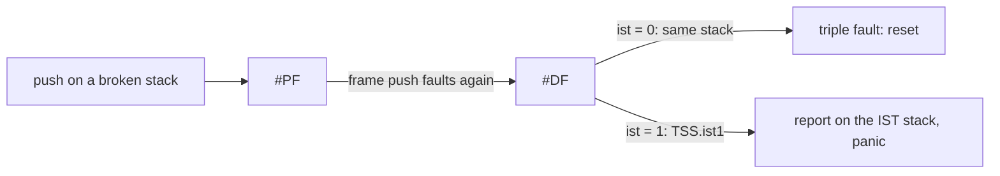

# GDT and TSS (`kernel/arch/x86_64/gdt/`)

The Global Descriptor Table describes the segments the CPU may load into
`cs`, `ss`, `ds`, ...; the Task State Segment it points at holds the stacks
the CPU switches to on some interrupts.

## What is it for?

Segmentation is mostly switched off in 64-bit mode: base and limit of code and
data segments are ignored, every segment covers the whole address space. What
is left of the GDT:

- **The privilege level.** The `cs` selector says whether the CPU runs in ring 0
  (kernel) or ring 3 (user). A ring 3 program needs its own code and data
  descriptors with DPL 3.
- **The long mode bit.** The `L` flag of the code descriptor makes it a 64-bit
  segment.
- **The TSS descriptor.** In long mode the TSS no longer stores a task's
  registers (hardware task switching is gone); it only stores stack pointers:

| Field | Used when |
|---|---|
| `rsp0` (`rsp[0]`) | an interrupt arrives while the CPU runs in ring 3: the CPU switches to this kernel stack before pushing anything |
| `ist1..ist7` | the IDT gate of a vector has a non-zero `ist` field: the CPU *always* switches to that stack, even in ring 0 |
| I/O map base | which I/O ports ring 3 may use; `sizeof(TSS)` means "no bitmap, none" |

## Why a double fault needs its own stack

When the kernel stack overflows into unmapped memory, the next push faults
(#PF). To deliver the page fault the CPU pushes its frame on the *same* stack,
which faults again, and that becomes a double fault (#DF). If the double fault
handler also uses the broken stack, delivering it fails too: a **triple
fault**, and the machine resets without a word.

With `ist = 1` in IDT entry 8 the CPU loads `rsp` from `TSS.ist1` before
pushing the double fault frame, so the handler runs and can report.

## How could it be designed?

| Question | Options |
|---|---|
| Where is the GDT? | **a static table** · built at run time · one per CPU (SMP: each CPU needs its own TSS, so its own TSS descriptor) |
| Where are the IST stacks? | **a static array in `.bss`** · pages from the VMM, with an unmapped guard page below so an overflow of the IST stack itself is caught |
| How many IST stacks? | **only the double fault** · also NMI and machine check (Linux uses separate ones for #DF, NMI, #DB, #MC) |

## How atlOS does it

- **The GDT is a static table** in `.bootdata` (`gdt.cpp`), loaded by `boot.S`
  before the jump to 64-bit code: null, kernel code (`0x08`), kernel data
  (`0x10`), user code (`0x18 | 3`), user data (`0x20 | 3`), and the TSS
  descriptor (`0x28`).
- **The TSS descriptor is filled in by `GDT::init()`** at boot: the TSS lives
  in the higher half and a system descriptor in long mode is **16 bytes**
  (a 64-bit base), so it takes slots 5 and 6. Type 9 means "available 64-bit
  TSS"; `ltr 0x28` loads it and the CPU changes the type to 11 ("busy").
- **One CPU, one TSS**, a static object like the IDT: it is hardware state,
  not something to pass around.
- **IST1 = a 16 KB static stack** (`s_doubleFaultStack`, 16 byte aligned), used
  only by vector 8. No guard page: the double fault handler only reports.
- `rsp0` stays 0 until there is a user mode.
- `GDT::init()` runs before `IDT::init()` in `kernelMain`.

### Deliberately not done

- No guard pages below the stacks (the thread stacks have none either).
- No per CPU GDT/TSS (no SMP).
- The GDT stays where `boot.S` loaded it, at its physical address through the
  identity mapping of the first megabytes.

## Tests

*TSS and double fault stack* (`kernel/tests/selftest.cpp`): the task register
holds `0x28`, the descriptor is busy (type 11), the GDT limit covers 7 slots,
IST1 points at an aligned stack top and only IDT entry 8 uses it. The double
fault path itself was tried by loading an unmapped `rsp` and executing `int3`:
the report appears on the IST stack instead of a reset.

## References

- OSDev Wiki: [Global Descriptor Table](https://wiki.osdev.org/Global_Descriptor_Table),
  [GDT Tutorial](https://wiki.osdev.org/GDT_Tutorial),
  [Task State Segment](https://wiki.osdev.org/Task_State_Segment),
  [Double Fault](https://wiki.osdev.org/Exceptions#Double_Fault)
- Intel SDM Vol. 3A: "Segment Descriptors", "TSS Descriptor in 64-bit mode",
  "Task Management in 64-bit Mode", "Interrupt 8—Double Fault Exception",
  "Interrupt Stack Table"
- Linux: `Documentation/arch/x86/kernel-stacks.rst` (IST usage)
