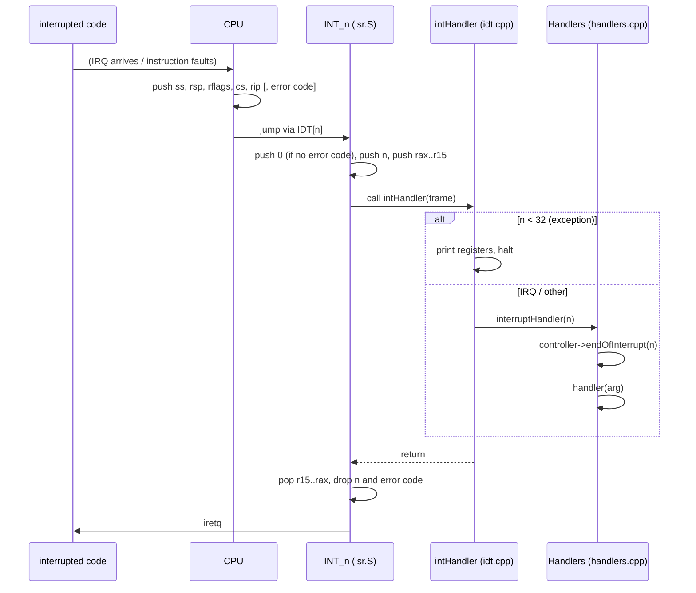

# Interrupts and exceptions (`kernel/arch/x86_64/idt/`)

How the CPU gets from "something happened" (a division by zero, a page fault,
a timer tick) to a C++ handler, and back.

## What is it for?

Three things interrupt the normal flow of instructions:

| Kind | Source | Examples (vector) |
|---|---|---|
| **Exception** | the CPU itself, caused by the current instruction | divide error (0), invalid opcode (6), general protection (13), page fault (14) |
| **Hardware interrupt (IRQ)** | a device, through the interrupt controller | PIT timer (0x20), keyboard (0x21) |
| Software interrupt | an `int n` instruction | system calls in some OSes (`int 0x80`) |

For each of the 256 vectors the **IDT** (Interrupt Descriptor Table) holds a
*gate*: the address of the code to run and how to enter it. The CPU saves the
interrupted `rip`, `cs`, `rflags`, `rsp`, `ss` (and for some exceptions an
error code) on the stack and jumps there; `iretq` returns.

## How could it be designed?

| Question | Options |
|---|---|
| One entry point per vector, or one for all? | **a small assembly stub per vector** that pushes its number and jumps to a common path (almost everyone) · a single entry that reads the vector from the APIC (not possible on x86 for exceptions) |
| Which gate type? | *interrupt gate*: clears IF, no nested interrupts · *trap gate*: leaves IF as it was |
| Separate stacks? | handle everything on the current stack · **IST** stacks from the TSS for faults where the stack itself may be broken (double fault, NMI) |
| Dispatch in C | a big `switch` · a table of registered handlers · both |

## How atlOS does it

```
isr.S          INT_<n> stubs: push a dummy error code if the CPU did not,
               push n, push rax..r15, call intHandler(frame), pop, iretq
idt.cpp        builds the IDT: 0..31 trap gates, 32..255 interrupt gates;
               intHandler: exceptions -> register dump and halt,
               everything else -> Handlers::interruptHandler(vector)
handlers.cpp   table of (function, argument) per vector; sends the EOI
               through the bound InterruptController, then calls the handler
```

- **Stubs** are generated with `.rept` macros. The CPU pushes an error code
  only for vectors 8, 10–14, 17 and 21; the others push a `0` so every frame has
  the same layout (`InterruptFrame` in `cpu/cpu.hpp`).
- **Stack alignment**: the CPU aligns `rsp` to 16 before pushing its frame; 5
  qwords + error code + vector + 15 registers = 22 qwords, so `rsp` is still
  16-byte aligned at the `call`, as the ABI requires. No padding needed.
- **Trap gates for exceptions**, interrupt gates for IRQs: an IRQ handler runs
  with interrupts off, so it can not be interrupted by itself.
- **Dispatch table**: drivers register `(function, argument)` pairs through
  their `InterruptController` (`PIC::attach` writes vector `0x20 + irq`).
  The argument is how a handler gets its object (e.g. the scheduler) without a
  global.
- The only global here is the bound controller pointer
  (`Handlers::setInterruptController`): the assembly stubs can not be handed an
  object.

### Bugs this code had (and why they matter)

The first version added the interrupted code's `r12` to `rsp` after the call
and popped the vector and error code into `rax`, overwriting it. Nothing
noticed while IRQs were off; the first timer interrupt corrupted the stack. The
*Interrupts* self test now puts known values in `rax` and `r12`, waits for an
interrupt with `hlt` and checks they survived.

### Deliberately not done

- No TSS yet, so no IST: a kernel stack overflow becomes a double fault on the
  same broken stack, then a triple fault (CPU reset).
- Exceptions only print and halt; nothing is recovered, the page fault address
  (CR2) is not decoded yet.
- Reserved vectors (9, 15, 22–31) have no stub.

## Flow: one interrupt



## Tests

*Interrupts*: the timer ticks, and an interrupt preserves `rax`/`r12`.
*PIT (fake interrupt controller)* covers registration through the controller.

## References

- OSDev Wiki: [Interrupt Descriptor Table](https://wiki.osdev.org/Interrupt_Descriptor_Table),
  [Interrupt Service Routines](https://wiki.osdev.org/Interrupt_Service_Routines),
  [Exceptions](https://wiki.osdev.org/Exceptions), [Task State Segment](https://wiki.osdev.org/Task_State_Segment)
- Intel SDM Vol. 3A, chapter "Interrupt and Exception Handling" (gate types,
  stack frame, error codes, IST)
- xv6 book (MIT 6.1810): chapter "Traps and system calls"
- *Operating Systems: Three Easy Pieces*: "Limited Direct Execution"
