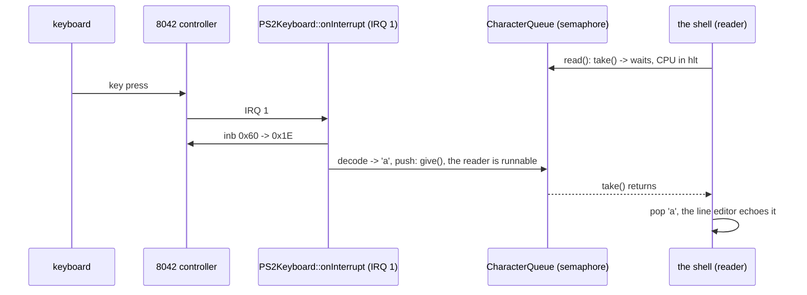
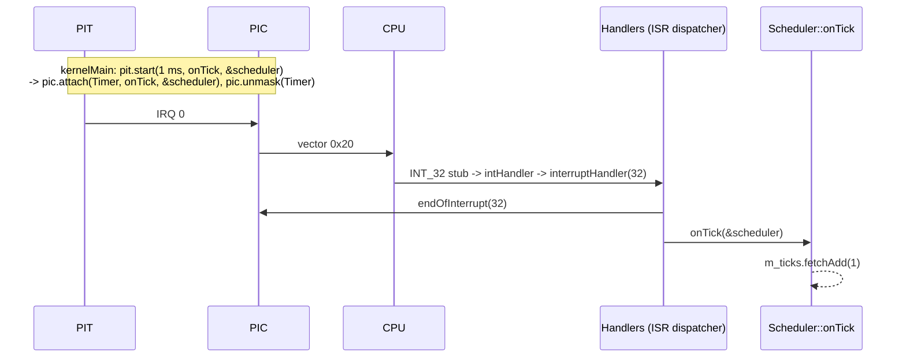

# Drivers (`kernel/drivers/`)

Code that talks to hardware: the interrupt controller, the timer, the serial
port, the VGA text screen, the keyboard and ATA disks.

## What is it for?

Hardware is controlled through **I/O ports** (`in`/`out` instructions, e.g.
`0x20` for the PIC, `0x3F8` for COM1) or **memory mapped registers** (e.g. the
VGA text buffer at `0xB8000`). A driver hides those details behind something
the rest of the kernel can call: "write these bytes", "call me every 1 ms",
"tell me when IRQ 1 fires".

## How could it be designed?

| Question | Options |
|---|---|
| How do users reach a driver? | call its functions directly · **through a small interface** (abstract class) · a generic device model (Linux `struct device`, file operations) |
| How many instances? | global/singleton per device · **objects created by the composition root** |
| How does the driver learn about events? | **polling** status registers · interrupts (IRQ handler) · DMA + interrupt |

A direct call is the simplest, but then every caller depends on one concrete
chip. An interface costs one virtual call and lets the chip be replaced (PIC →
APIC) or faked in a test without touching the callers.

## How atlOS does it

Small interfaces, concrete drivers as objects, created and wired in
`kernelMain`:

| Interface | Implementations | Used by |
|---|---|---|
| `InterruptController` (`interrupt_controller.hpp`) | `PIC` (8259 pair) | PIT, keyboard, the ISR dispatcher |
| `TickSource` (`tick_source.hpp`) | `PIT` (8253/8254 channel 0) | `Threading::Scheduler` |
| `CharacterSink` (`character_sink.hpp`) | `SerialPort`, `VGATextConsole`, `TeeSink` (both at once) | the console behind `printf` |
| `CharacterSource` (`character_source.hpp`) | `CharacterQueue` (fed by `PS2Keyboard` and `SerialPort`) | the shell |
| `BlockDevice` (`disk/block_device.hpp`) | `ATAPioDevice`, `PartitionDevice`, `MemoryBlockDevice` | the file systems (`kernel/fs/`) |

- **PIC**: the constructor remaps the 16 IRQs to vectors `0x20..0x2F` (by
  default they collide with CPU exceptions) and masks every line. A driver
  `attach`es its handler and `unmask`s only its own line. Slave IRQs also need
  the cascade line (IRQ 2) on the master.
- **PIT**: channel 0 in square wave mode; divisor = 1193182 Hz × period. The
  divisor is 16 bits, so periods above ~55 ms are refused.
- **SerialPort**: 16550 UART at 38400 8N1. A loopback test in the constructor
  tells whether the port exists; a missing port drops writes instead of
  waiting forever for its transmitter. Writes turn `\n` into `\r\n`.
  `startReceiving(controller, queue)` turns on the "data received" interrupt
  (IRQ 4 for COM1) and pushes every byte into a `CharacterQueue`.
- **TeeSink**: writes to two sinks; with a COM1 the console is
  `TeeSink(screen, serial)`, so output shows on both.
- **VGATextConsole**: 80×25 cells of `char | color << 8`. The buffer pointer is
  a constructor argument (the real screen by default), so the tests run it on
  RAM. It understands what a serial terminal does, so the same bytes look
  alike on both: ANSI colors (`ESC [ 93 m` bright yellow, `ESC [ 0 m` reset;
  other escape sequences are skipped) and UTF-8 for the block characters
  `▀ ▄ █ ░ ▒ ▓`, shown with the VGA font's code page 437 glyphs (other
  characters become `?`).
- **PS2Keyboard**, see below. Interrupt driven: input arrives whenever the
  user types, polling would have to look all the time.
- The output drivers poll their status registers: the simplest way to use a
  device that answers within microseconds.

### Disks (`disk/`)

- **ATAPioDevice** (`ata.cpp`): an IDE disk through the legacy ports
  (`0x1F0`/`0x170`). The constructor sends IDENTIFY DEVICE: no answer (a
  floating bus reads `0xFF`, an empty slot `0`) or an ATAPI signature (a CD
  drive) means "not present"; otherwise words 60..61 give the sector count and
  27..46 the model. Reads and writes are 28-bit LBA PIO commands: per sector,
  wait for DRQ, move 256 words with `in`/`out`. Every wait has a limit, so a
  broken or missing drive fails a call instead of hanging the kernel. The
  channel's IRQ is turned off (nIEN): the driver polls. Writes end with
  FLUSH CACHE.
- **PartitionDevice** (`partition.cpp`): a range of another device, starting
  at its sector 0. `readPartitionTable` reads the four MBR entries and
  rejects a sector 0 whose entries do not fit the disk (e.g. a disk formatted
  without partitions, whose boot sector also ends in `0x55AA`).
- **MemoryBlockDevice**: a disk in RAM, for testing file systems.

Polling is the simplest way to use a disk and fine with a cooperative
scheduler that has nothing else to do; IRQ 14 + `Sync::Semaphore` would let
another thread run while the disk seeks.

### The keyboard (`keyboard.cpp`, `scancode.cpp`)

The keyboard talks to the 8042 PS/2 controller, which raises IRQ 1 for every
byte and translates whatever the keyboard speaks to **scancode set 1**
(also what USB keyboards look like with the firmware's legacy emulation):

```
press "a"        1E            make code
release "a"      9E            make | 0x80 = break code
press right Ctrl E0 1D         0xE0: a key added after the original 83 keys
Shift + "1"      2A 02 82 AA   the driver keeps track of Shift itself
```

Bytes become characters in three steps:

1. `ScancodeDecoder::feed(byte)` (pure, no hardware): handles the `0xE0`
   prefix, skips Pause and controller answers (`0xFA`, `0xFE`), tracks Shift,
   Ctrl, Alt and Caps Lock, and returns a `KeyEvent`.
2. The **layout** (`KeyboardLayout`: two tables indexed by make code,
   without and with Shift) gives the character; Caps Lock flips letters
   only, Ctrl+letter gives the control characters 1..26 (Ctrl+C = 3). Only
   US QWERTY exists; another layout is two more tables.
3. `PS2Keyboard` pushes the character into a **`CharacterQueue`** (a 128
   byte ring buffer; a counting `Sync::Semaphore` counts the characters, the
   IRQ handler `give`s, `read()` `take`s, so a reader sleeps until a key
   arrives, see `kernel/sync/README.md`). The serial port pushes into the
   same queue: the shell reads both. A full queue drops new characters
   (counted in `droppedCount`), so what was typed first keeps its order.
   The arrow keys become the ANSI sequences of a terminal (`ESC [ A` up,
   `B` down, `C` right, `D` left), pushed whole or not at all.

The constructor empties the controller's output buffer first: a byte left by
the firmware that nobody reads keeps IRQ 1 from firing again. It does not
reset or configure the controller (it relies on the firmware's setup).



### Deliberately not done

- No generic device model or driver registry; `kernelMain` creates the few
  drivers there are.
- Disks: no DMA, no AHCI (SATA in native mode), no 48-bit LBA (2^28 sectors
  = 128 GB is the limit), no GPT.
- Keyboard: no controller self test or reset, no LEDs, no key repeat
  settings, no Num Lock (the keypad always types digits), no key events for
  keys without a character (arrows) in the character stream, US layout only.
- No APIC/IOAPIC, no PCI, no DMA.

## Flow: an IRQ from the PIT to the scheduler



## Tests

*PIT (fake interrupt controller)* drives the PIT against a fake controller and
checks what it attaches and unmasks. *Scancode decoder* feeds byte sequences
(Shift, Caps Lock, Ctrl, extended keys, Pause); *PS/2 keyboard and the character queue* injects scancodes the way the IRQ
handler does and checks arrow sequences, blocking reads and a full queue. *Console (fake sink)*, *VGA text console
(RAM buffer)* and *Serial port (missing COM2)* test the output side.

## References

- OSDev Wiki: [8259 PIC](https://wiki.osdev.org/8259_PIC),
  [Programmable Interval Timer](https://wiki.osdev.org/Programmable_Interval_Timer),
  [Serial Ports](https://wiki.osdev.org/Serial_Ports),
  [Text Mode Cursor](https://wiki.osdev.org/Text_Mode_Cursor), [I/O Ports](https://wiki.osdev.org/I/O_Ports),
  ["8042" PS/2 Controller](https://wiki.osdev.org/I8042_PS/2_Controller),
  [PS/2 Keyboard](https://wiki.osdev.org/PS/2_Keyboard) (scancode set 1 table),
  [ATA PIO Mode](https://wiki.osdev.org/ATA_PIO_Mode), [MBR (x86)](https://wiki.osdev.org/MBR_(x86))
- ATA/ATAPI-6 (T13 1410D): IDENTIFY DEVICE data words
- Intel 8259A and 8254 data sheets; National Semiconductor PC16550D data sheet
- xv6 book (MIT 6.1810): chapter "Interrupts and device drivers"
