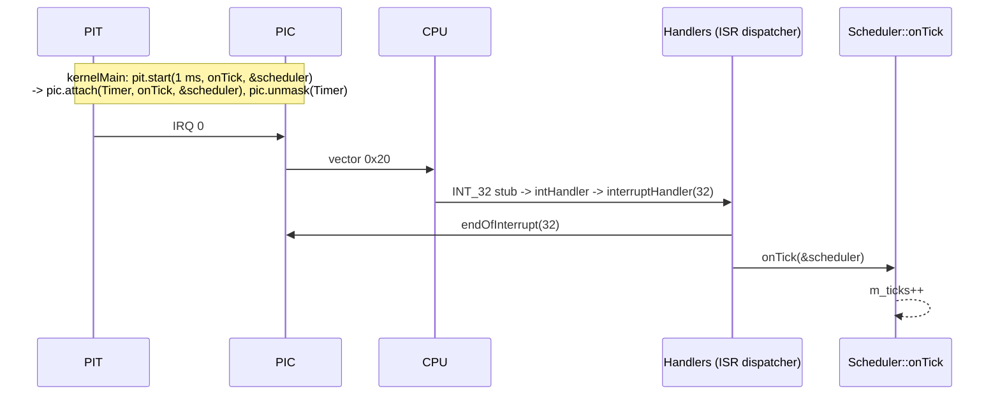

# Drivers (`kernel/drivers/`)

Code that talks to hardware: the interrupt controller, the timer, the serial
port, the VGA text screen, and (not started yet) the keyboard and ATA disks.

## What is it for?

Hardware is controlled through **I/O ports** (`in`/`out` instructions, e.g.
`0x20` for the PIC, `0x3F8` for COM1) or **memory mapped registers** (e.g. the
VGA text buffer at `0xB8000`). A driver hides those details behind something
the rest of the kernel can call: "write these bytes", "call me every 1 ms",
"tell me when IRQ 1 fires".

## How could it be designed?

| Question | Options |
|---|---|
| How do users reach a driver? | call its functions directly · **through a small interface** (abstract class) · a generic device model (Linux `struct device`, file operations) |
| How many instances? | global/singleton per device · **objects created by the composition root** |
| How does the driver learn about events? | **polling** status registers · interrupts (IRQ handler) · DMA + interrupt |

A direct call is the simplest, but then every caller depends on one concrete
chip. An interface costs one virtual call and lets the chip be replaced (PIC →
APIC) or faked in a test without touching the callers.

## How atlOS does it

Small interfaces, concrete drivers as objects, created and wired in
`kernelMain`:

| Interface | Implementations | Used by |
|---|---|---|
| `InterruptController` (`interrupt_controller.hpp`) | `PIC` (8259 pair) | PIT, keyboard, the ISR dispatcher |
| `TickSource` (`tick_source.hpp`) | `PIT` (8253/8254 channel 0) | `Threading::Scheduler` |
| `CharacterSink` (`character_sink.hpp`) | `SerialPort`, `VGATextConsole` | the console behind `printf` |

- **PIC**: the constructor remaps the 16 IRQs to vectors `0x20..0x2F` (by
  default they collide with CPU exceptions) and masks every line. A driver
  `attach`es its handler and `unmask`s only its own line. Slave IRQs also need
  the cascade line (IRQ 2) on the master.
- **PIT**: channel 0 in square wave mode; divisor = 1193182 Hz × period. The
  divisor is 16 bits, so periods above ~55 ms are refused.
- **SerialPort**: 16550 UART at 38400 8N1. A loopback test in the constructor
  tells whether the port exists; a missing port drops writes instead of
  waiting forever for its transmitter.
- **VGATextConsole**: 80×25 cells of `char | color << 8`. The buffer pointer is
  a constructor argument (the real screen by default), so the tests run it on
  RAM.
- Polling everywhere except the timer: the simplest way to use a device.
  Whether the disk and keyboard move to interrupts is still open.

Not started yet: `keyboard.cpp` (PS/2, IRQ 1) and `disk/` (ATA PIO); they
exist from earlier work but nothing creates them.

### Deliberately not done

- No generic device model or driver registry; `kernelMain` creates the few
  drivers there are.
- No APIC/IOAPIC, no PCI, no DMA.

## Flow: an IRQ from the PIT to the scheduler

## Tests

*PIT (fake interrupt controller)* drives the PIT against a fake controller and
checks what it attaches and unmasks. *Console (fake sink)*, *VGA text console
(RAM buffer)* and *Serial port (missing COM2)* test the output side.

## References

- OSDev Wiki: [8259 PIC](https://wiki.osdev.org/8259_PIC),
  [Programmable Interval Timer](https://wiki.osdev.org/Programmable_Interval_Timer),
  [Serial Ports](https://wiki.osdev.org/Serial_Ports),
  [Text Mode Cursor](https://wiki.osdev.org/Text_Mode_Cursor), [I/O Ports](https://wiki.osdev.org/I/O_Ports)
- Intel 8259A and 8254 data sheets; National Semiconductor PC16550D data sheet
- xv6 book (MIT 6.1810): chapter "Interrupts and device drivers"
