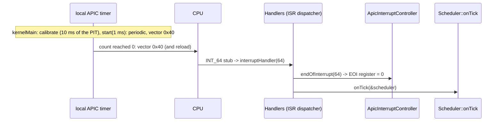
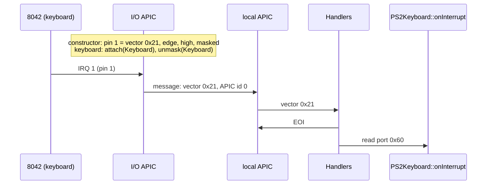

# The APIC (`kernel/drivers/apic/`)

The interrupt controller of every x86 machine since the Pentium: one **local
APIC** in each processor, one or more **I/O APICs** on the motherboard that
collect the device interrupts. When the firmware describes them (the ACPI
MADT, see `kernel/firmware/acpi/`), atlOS takes its IRQs through them and its
scheduler tick from the local APIC's timer. The shell's `apic` shows their
state.

```
atlOS:/> apic
local APIC id 0, version 0x14, 6 LVT entries, at 0xfee00000
  spurious 0x1ff (enabled, vector 0xff), task priority 0, error status 0x0
  timer  0x00020040  vector 0x40
  LINT0  0x00008700  ExtINT
  LINT1  0x00008400  NMI
  error  0x00010000  vector 0x00  masked
  timer: periodic, 63198300 Hz (bus clock / 16), count 33484 of 63198
I/O APIC id 0, version 0x20, 24 pins (GSI 0 .. 23), at 0xfec00000
  IRQ  GSI  pin  entry               vector  trigger  polarity  to APIC
    0    2    2  0x0000000000010020  0x20    edge     high      0  masked
    1    1    1  0x0000000000000021  0x21    edge     high      0
    2  (not routed)
  ...
```

## What is it for?

The **8259 PIC** (`../pic.cpp`) has 16 inputs, all of them going to one
processor. That was the IBM PC/AT in 1984. It has no room for more devices and
no way to send an interrupt to a second processor. The **APIC** (Advanced
Programmable Interrupt Controller) replaces it in two parts:

```
 devices ── IRQ lines ──► I/O APIC ──┐   (a message on the system bus:
                         24 pins,     │    "vector 0x21 to APIC id 0")
                     redirection table│
                                      ▼
                processor 0: local APIC ── vector ──► the CPU's IDT
                             timer, LINT0, LINT1, error (its own interrupts)
                processor 1: local APIC ...
```

- The **I/O APIC** has a pin per interrupt line and a **redirection table**:
  one 64 bit entry per pin that says which vector to send, to which local
  APIC, edge or level triggered, active high or low, masked or not.
- The **local APIC** receives those messages, decides by priority when the
  CPU takes them, and is told when a handler is done (**EOI**, end of
  interrupt). It also has interrupt sources of its own, set in its **local
  vector table** (LVT): a **timer**, two pins (LINT0, LINT1: where the old PIC
  and the NMI line arrive) and its error interrupt.
- Each processor has its own local APIC and timer, which is why SMP needs the
  APIC: the PIC can not interrupt the second processor, and the PIT is one
  timer for all of them.

The registers are **memory mapped** (xAPIC): the local APIC at `0xFEE00000`,
the I/O APIC at `0xFEC00000` on most machines, but the MADT says where. A
local APIC register is a 32 bit value at a 16 byte aligned offset. An I/O APIC
has only two registers in memory, an index (`IOREGSEL`) and a data window
(`IOWIN`): write the number of the register you want, then read or write it.

Device registers must not be cached: a read has to reach the device, and a
write must not wait in a cache. The page that maps them has the **cache
disable** and **write through** bits set (`AddressSpace::mapDevice`).

### The timer and why it needs measuring

The local APIC timer counts down from an initial count at the bus clock
divided by 1..128, and interrupts at 0. In periodic mode it reloads and goes
on. The bus clock is not written down anywhere the kernel can read (newer
CPUs report it in CPUID leaf 0x15, but not all), so the kernel measures it
against a timer whose frequency it does know: the PIT runs at 1193182 Hz on
every PC. Start the APIC timer at the largest count, wait 10 ms on the PIT,
see how far it got.

### The ISA IRQs and the overrides

The old devices (PS/2 keyboard, COM ports, the PIT) still raise ISA IRQ 0..15.
On the I/O APIC they are on the GSI of the same number, except where an MADT
**interrupt source override** says otherwise. The PIT's IRQ 0 is on GSI 2 on
almost every machine, and some overrides make a line level triggered or
active low.

## How could it be designed?

| Question | Options |
|---|---|
| Register access | **xAPIC: memory mapped** · x2APIC: MSRs `0x800+`, needed beyond 255 APIC ids (`rdmsr`/`wrmsr`, no mapping) |
| Where ISA IRQ *n* goes | **vector `0x20 + n`, as with the PIC** · vectors given out on demand (Linux) · by priority class (the upper 4 bits of a vector are its priority) |
| Which processor | **the one that boots** · spread over all of them · the lowest priority one (logical destination mode) |
| The timer | **periodic, measured against the PIT** · one shot, programmed for the next event (tickless) · TSC deadline mode (an MSR with an absolute TSC value) · the HPET |
| Without ACPI | **fall back to the PIC and the PIT** · the MP table (the pre-ACPI way) · refuse to boot |

## How atlOS does it

| Class | File | What it does |
|---|---|---|
| `LocalApic` | `local_apic.cpp` | the registers; `enable` sets the global enable (`IA32_APIC_BASE` bit 11), task priority 0 and the spurious vector `0xFF` with the software enable bit; `endOfInterrupt` |
| `IoApic` | `io_apic.cpp` | the index/data window (with interrupts off between the two accesses), the pin count from the version register, redirection entries (written masked first, so half an entry never delivers) |
| `ApicInterruptController` | `apic.cpp` | the `InterruptController` for the APIC path |
| `ApicTimer` | `apic_timer.cpp` | the `TickSource` for the APIC path |

- **`ApicInterruptController`**: the constructor masks every pin of every
  I/O APIC, enables the local APIC, and routes the 16 ISA IRQs: for each one
  `isaRoute` from the MADT gives the GSI and the line's polarity and trigger
  mode, the I/O APIC whose range has that GSI gets an entry with vector
  `0x20 + irq`, fixed delivery, physical destination (the boot processor's
  APIC id), **masked**. An IRQ whose GSI another IRQ was overridden to is not
  routed (IRQ 2, the old cascade, loses GSI 2 to the timer). `attach` sets the
  handler and `unmask`/`mask` flip bit 16 of the entry, as the PIC's mask
  does. `endOfInterrupt` writes the local APIC's EOI register for the IRQ
  vectors and the timer vector, and for nothing else: a software `int` was
  never in service, and a **spurious** interrupt (one that went away before
  the CPU took it) must not get an EOI.
- **`ApicTimer`**: `calibrate` (interrupts off) divides by 16, starts a
  masked one shot count at `0xFFFFFFFF`, waits 10 ms with `pitBusyWait`
  (PIT channel 2, polled; `../pit.cpp`) and multiplies what was counted by
  100. `start(1 ms)` then puts the timer in periodic mode on vector `0x40`
  with an initial count of frequency / 1000.
- **`kernelMain`** (`kernel/core/main.cpp`) chooses, in one place: a MADT
  with an I/O APIC and a processor with a local APIC (CPUID.1:EDX bit 9) mean
  the APIC; otherwise the PIC and the PIT. The 8259 PIC is set up in both
  cases (remapped, every line masked), so with the APIC it can not deliver
  anything. If measuring the timer fails, the PIT ticks instead, through the
  I/O APIC.

The drivers that use an IRQ (the keyboard, COM1, the PIT) did not change: they
only know `InterruptController`.

### Deliberately not done

- No x2APIC; xAPIC works on every x86_64 processor up to 255 APIC ids.
- The LINT pins stay as the firmware set them (LINT0 ExtINT for the PIC,
  LINT1 NMI); the MADT's NMI entries are read and shown, not programmed.
- No IMCR (the port `0x22`/`0x23` switch of some old MP boards between "PIC
  mode" and "APIC mode"): ACPI machines do not need it.
- One processor: the other local APICs are listed (`acpi APIC`), not started
  (that is SMP: INIT and startup IPIs).
- Only the ISA IRQs are routed; PCI interrupts (the other GSIs, and MSI) need
  the AML (`_PRT`) or MSI programming.
- No TSC deadline mode, no tickless timer.

## Flow: the timer tick



## Flow: a key press through the I/O APIC



## Tests

- *ACPI and the APIC on this machine*: the local APIC's id is the one CPUID
  reports, it is enabled with the spurious vector; IRQ 0 is on the GSI the
  MADT says, vector `0x20`; IRQ 2 is not routed when IRQ 0 took its GSI; the
  8259s stay masked; the PIT through the I/O APIC delivers IRQ 0 (the
  override at work); the timer runs periodic on vector `0x40`, and 50 ms of
  PIT channel 2 take 40 to 60 ticks.
- *Interrupt counts*, *Raising interrupts* and the scheduler tests run on the
  tick that is in use, APIC timer or PIT.
- Shell test: `apic` on QEMU (the timer periodic, COM1 unmasked), `irq` counts
  the APIC timer.
- By hand: `-machine acpi=off` (the PIC path, the APIC tests skipped),
  `-machine q35`, `-smp 2`.

## References

- OSDev Wiki: [APIC](https://wiki.osdev.org/APIC), [IOAPIC](https://wiki.osdev.org/IOAPIC),
  [APIC Timer](https://wiki.osdev.org/APIC_Timer), [MADT](https://wiki.osdev.org/MADT)
- Intel SDM Vol. 3A, chapter 11 "Advanced Programmable Interrupt Controller
  (APIC)" (11.5.4 the timer, 11.8 handling interrupts, 11.9 spurious interrupts)
- Intel 82093AA I/O APIC data sheet (the registers and the redirection table)
- Linux: `arch/x86/kernel/apic/apic.c` (`calibrate_APIC_clock`), `io_apic.c`
