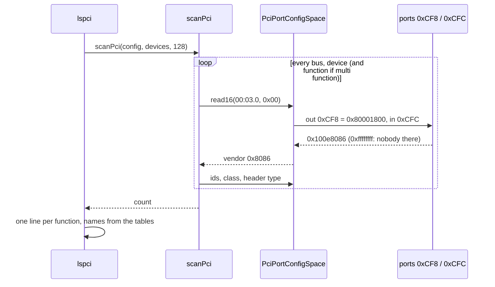

# PCI and PCIe (`kernel/drivers/pci/`)

Finding out what is plugged into the machine: the disk controllers, the
network card, the graphics card, the USB controllers. This directory reads
the PCI configuration space, scans every bus for functions and names what
it finds; the shell's `lspci` shows the result.

```
atlOS:/> lspci
  00:00.0  8086:29c0  0600  Intel            Host bridge
  00:02.0  8086:10d3  0200  Intel            Ethernet controller
  00:03.0  1b36:000c  0604  Red Hat          PCI bridge
  00:1f.2  8086:2922  0106  Intel            SATA controller
  01:00.0  8086:10d3  0200  Intel            Ethernet controller
  ...
```

## What is it for?

Old ISA devices sat at fixed addresses everyone knew: the keyboard
controller at port `0x60`, the first IDE channel at `0x1F0`. A driver could
simply assume them. That does not scale: two cards of the same kind would
collide, and nobody can know in advance what a machine contains.

**PCI** solves this. Every device has a small block of registers, its
**configuration space**, that the CPU can always reach, even before the
device is set up. It says:

- **who** it is: a vendor id (`0x8086` Intel) and a device id the vendor
  chose (`0x100e`: an 82540EM network card),
- **what kind** of device it is: a class, a subclass and a programming
  interface (`01 06 01`: a SATA controller speaking AHCI),
- **where** its registers are: up to six **BARs** (base address registers),
  each one an I/O port range or a range of physical memory,
- how it **interrupts**, and which optional features (**capabilities**) it
  has.

A kernel reads this for every device, picks a driver by class or by
vendor and device id, and the driver finds its registers through the BARs.
Before AHCI, NVMe, USB or a network card can be driven, the kernel has to
find them this way.

### Addresses: bus, device, function

A machine has up to 256 **buses**, each with up to 32 **devices**, each
with up to 8 **functions**. One chip can be several functions (`00:01.0`
the ISA bridge, `00:01.1` the IDE controller of the same PIIX3 chip).
Written `bus:device.function` in hex: `00:1f.2`.

Bus 0 hangs off the **host bridge** (`00:00.0`, the CPU's side). A **PCI
bridge** (class `06 04`) connects another bus behind it: `00:03.0` above is
a bridge, `01:00.0` is the card behind it.

### PCI and PCIe

PCI Express replaced the shared parallel bus by point to point serial
links, but keeps PCI's software model: the same configuration space, the
same addresses, the same header. Each PCIe slot is a bridge (a *root port*)
with its own bus behind it. A PCIe function has more configuration space
(4096 bytes instead of 256), and a **PCI Express capability** in its
capability list. Through the old access method its first 256 bytes look
exactly like a PCI device; that is how atlOS sees it.

### The header (the first 64 bytes)

```
offset  0x00         0x02         0x04         0x06
        vendor id    device id    command      status
        0x08 rev     0x09 prog if 0x0a subclass 0x0b class
        0x0c ...     0x0e header type (bit 7: more functions)
        0x10 .. 0x27 BAR0 .. BAR5   (a bridge: BAR0, BAR1, then bus numbers)
        0x34         the first capability
        0x3c         interrupt line (the IRQ)   0x3d interrupt pin (INTA..INTD)
```

A **BAR** with bit 0 set is an I/O port base; otherwise it is a memory
base, bits 2..1 say 32 or 64 bit (a 64 bit BAR takes the next one as its
upper half), bit 3 says prefetchable. The **capabilities** are a linked
list in the configuration space: each entry is an id and the offset of the
next one.

## How could it be designed?

| Question | Options |
|---|---|
| Reaching the configuration space | **Configuration Mechanism #1: ports `0xCF8` (the address) and `0xCFC` (the data)**: every PC has it, 256 bytes per function · **ECAM** (PCIe): all 4096 bytes mapped into memory, its address in the ACPI `MCFG` table · Mechanism #2 (obsolete) · the BIOS (`int 0x1A`, real mode only) |
| Finding the functions | **try every bus, device and function** (256 × 32 × 8) · start at bus 0 and follow each bridge to the bus behind it · ask the firmware (ACPI) |
| BAR sizes | read only, no sizes · write all ones, read back, restore: the low bits that stay 0 give the size |
| Names | **small built in tables** · the `pci.ids` database (thousands of vendors and devices, what Linux `lspci` uses) |

## How atlOS does it

- **`PciConfigSpace`** (`config_space.hpp`): an interface with `read32`;
  `read16`/`read8` take their part of the 32 bit value. Nothing writes: the
  scan and `lspci` only look.
- **`PciPortConfigSpace`**: Mechanism #1. The address written to `0xCF8` is

  ```
  bit 31   enable
  23..16   bus
  15..11   device
  10..8    function
   7..2    the register (offset / 4)
  ```

  then `0xCFC` holds the 32 bits. The two port accesses run with interrupts
  off, so nothing can move `0xCF8` in between. A function that does not
  exist reads as all ones: vendor `0xFFFF`.
- **`scanPci`** (`pci.cpp`): tries every bus and device. If function 0
  answers and has the multi function bit, functions 1..7 are tried too. It
  fills an array of `PciDevice` (address, ids, class, header type). Trying
  all 8192 places costs a few milliseconds and can not miss a bus, even
  one behind a bridge the firmware set up oddly.
- **Names**: `pciClassName` (the common subclasses, otherwise the class),
  `pciVendorName` (a few vendors), `pciCapabilityName`.
- **`lspci`** (the shell) scans on every call: one line per function, or
  `lspci bb:dd.f` for one function's header decoded (command bits, BARs,
  interrupt pin, capabilities) and dumped.

The interface lets the self tests put a made up bus behind it.

### Deliberately not done

- No ECAM: the 4096 byte PCIe configuration space (extended capabilities
  like AER) is not reachable. It needs the ACPI tables first.
- No writes: no BAR sizing, no enabling of bus mastering or memory
  decoding; a driver will need them.
- No drivers on top yet, no MSI/MSI-X setup.
- The boot does not scan; only `lspci` does.

## Flow: `lspci`



## Try it

QEMU's default machine (`pc`, i440FX) has plain PCI devices only. Its `q35`
machine is PCIe; a PCIe network card behind a root port:

```sh
qemu-system-x86_64 -machine q35 -cdrom build/default/atlOS.iso -m 512M -serial stdio \
    -device pcie-root-port,id=rp1,chassis=1 -device e1000e,bus=rp1
```

```
atlOS:/> lspci 01:00.0
01:00.0  Ethernet controller
  vendor    0x8086 Intel
  device    0x10d3  revision 0x00
  ...
  capabilities: Power Management (0xc8) MSI (0xd0) PCI Express (0xe0) MSI-X (0xa0)
```

## Tests

- Self test *PCI: the scan and the names*: a made up bus
  (`FakePciConfigSpace`) with a multi function device, a device without the
  multi function bit (its function 1 must not be found), a function on
  bus 3, the capacity limit, 16 and 8 bit reads, the name tables; then the
  machine's own bus through the ports: a host bridge at `00:00.0`.
- Self test *Shell commands*: `lspci` on the made up bus (the list, 32 and
  64 bit memory BARs, an I/O BAR, the capability list, the header dump, bad
  addresses).
- Shell test: `lspci` and `lspci 00:01.1` on QEMU's machine.

## References

- OSDev Wiki: [PCI](https://wiki.osdev.org/PCI),
  [PCI Express](https://wiki.osdev.org/PCI_Express)
- PCI Local Bus Specification 3.0: chapter 6, "Configuration Space"; PCI
  Code and ID Assignment Specification (the class codes)
- [The PCI ID Repository](https://pci-ids.ucw.cz/): vendor and device names
- Linux: `drivers/pci/probe.c` (the scan), `lspci` from pciutils
