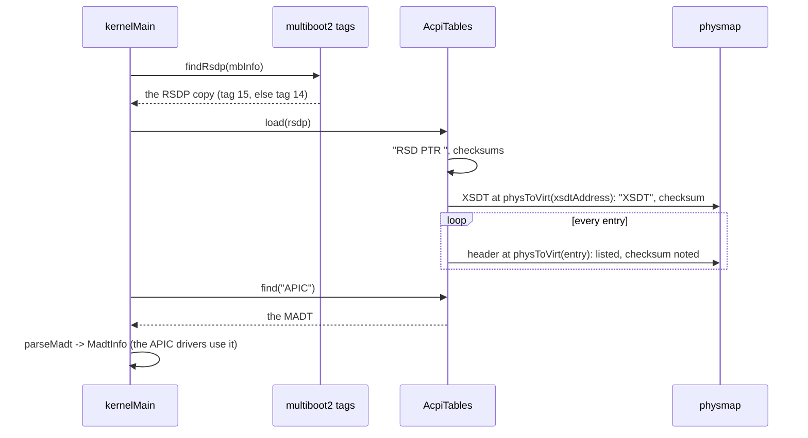

# ACPI tables (`kernel/firmware/acpi/`)

How the kernel learns what the motherboard does not say through PCI: how
many processors there are, where the interrupt controllers sit, how the old
ISA interrupts are wired. The firmware writes this down in **ACPI tables**;
this directory finds them, checks them and reads the one atlOS needs, the
**MADT**. The shell's `acpi` shows them.

```
atlOS:/> acpi
ACPI revision 0 (BOCHS ), RSDT at 0x1ffe1905
  sig   physical    length  rev  OEM
  FACP  0x1ffe17b9     116    1  BOCHS  BXPC      fixed hardware (FADT)
  APIC  0x1ffe182d     120    1  BOCHS  BXPC      interrupt controllers (MADT)
  HPET  0x1ffe18a5      56    1  BOCHS  BXPC      high precision event timer
  WAET  0x1ffe18dd      40    1  BOCHS  BXPC      emulated devices
  4 table(s)
```

## What is it for?

PCI devices describe themselves (see `kernel/drivers/pci/`). The parts of the
machine around the processor do not: the interrupt controllers, the timers,
power management, the processors themselves. Before ACPI every chipset had
its own conventions (and the MP table of the Intel MultiProcessor spec for
the APICs). **ACPI** (Advanced Configuration and Power Interface) gives the
firmware one format for all of it.

The firmware leaves a tree of tables in memory:

```
RSDP  "RSD PTR "  where it all starts: found by the boot loader (or by scanning the BIOS area)
 └── XSDT (ACPI 2.0+, 64 bit addresses) or RSDT (ACPI 1.0, 32 bit addresses)
      ├── FACP  the FADT: fixed hardware (power management ports, the reset register, ...)
      │    └── DSDT  AML byte code: the devices that need an interpreter to describe
      ├── APIC  the MADT: the local APICs (one per processor), the I/O APICs, the IRQ overrides
      ├── HPET  the high precision event timer
      ├── MCFG  where the PCIe configuration space is mapped (ECAM)
      └── ...   SSDT (more AML), SRAT (NUMA), DMAR (IOMMU), ...
```

Every table starts with the same 36 byte header (a 4 letter signature, its
length, a checksum, who made it) and is checked the same way: **all its bytes
add up to 0** (modulo 256).

Most of ACPI (power states, devices described in AML) needs a byte code
interpreter, like Intel's ACPICA or the one in Linux. The static tables do
not: they are plain structures to read. That is all atlOS reads.

### The MADT

The "Multiple APIC Description Table" (signature `APIC`) is a header, the
physical address of the local APICs and a flag ("there are 8259 PICs too"),
then a list of entries, each a type and a length:

| Type | Entry | What it says |
|---|---|---|
| 0 | Processor local APIC | ACPI processor id, its APIC id, enabled or not |
| 1 | I/O APIC | its id, the physical address of its registers, the first GSI it handles |
| 2 | Interrupt source override | ISA IRQ *n* arrives on GSI *m*, with this polarity and trigger mode |
| 3 | NMI source | a GSI that is a non maskable interrupt |
| 4 | Local APIC NMI | which LINT pin of the local APICs is the NMI |
| 5 | Local APIC address override | a 64 bit address instead of the 32 bit one in the header |

A **GSI** (global system interrupt) numbers the inputs of all I/O APICs
together: an I/O APIC with 24 pins and base 0 has GSI 0..23. ISA IRQ *n* is
on GSI *n* unless an override says otherwise; nearly every PC has
"IRQ 0 → GSI 2" because the timer is wired to the I/O APIC's pin 2.

## How could it be designed?

| Question | Options |
|---|---|
| Finding the RSDP | **from the boot loader** (multiboot2 copies it into a tag; UEFI has it in its configuration table) · scan the EBDA and `0xE0000..0xFFFFF` for `"RSD PTR "` on a 16 byte boundary (BIOS only) |
| Reading the tables | **in place, through the physmap** · copy each table into the heap · map each table on demand |
| What to read | **the static tables a driver needs (the MADT)** · a full ACPI implementation with an AML interpreter (ACPICA, `lai`, uACPI) |
| Bad checksums | refuse the table · **list it, but do not use it** · ignore checksums (some firmware is wrong) |

## How atlOS does it

- **`findRsdp(multibootInfo)`** (`acpi.cpp`) walks the multiboot2 tags: the
  ACPI 2.0 tag (type 15) if there is one, else the ACPI 1.0 tag (type 14).
  GRUB copies the RSDP into the tag, so there is nothing to scan.
- **`AcpiTables::load(rsdp)`** checks the RSDP (signature, the checksum of
  its first 20 bytes; for revision 2 the checksum of all of it), then the root
  table: the **XSDT** for revision 2 and later, the **RSDT** for ACPI 1.0.
  Its entries are physical addresses, 8 or 4 bytes each, and not always
  aligned (the XSDT's start at offset 36), so they are copied out byte by
  byte. Each table is reached through the physmap: ACPI tables sit in RAM
  that the memory map marks *ACPI reclaimable* or *reserved*, which the PMM
  never hands out. A table outside the physmap is skipped; one with a wrong
  checksum is listed but `find` skips it.
- **`parseMadt(table, info)`** (`madt.cpp`) reads the entries into a
  `MadtInfo`: the processors, the I/O APICs, the overrides, the NMI pins, the
  local APIC address (the 64 bit entry wins). Entries of other kinds are
  counted. An entry that runs past the end of the table makes the whole
  table invalid.
- **`isaRoute(info, irq)`** answers what an ISA IRQ driver needs: its GSI,
  active low or high, edge or level. Flags of 0 mean "as the bus does", which
  for ISA is active high and edge.

Everything is a plain structure in memory, so the self tests build tables
byte by byte and parse them.

### Deliberately not done

- No AML interpreter: the DSDT and SSDTs are not read, so no power off, no
  sleep states, no devices that only AML describes. The FADT is listed but
  not decoded.
- No scanning of the BIOS area for the RSDP: a boot loader without the ACPI
  tag means "no ACPI".
- MCFG, HPET, SRAT are listed only.
- At most 32 tables, 16 processors, 8 I/O APICs and 16 overrides.

## Flow: from the boot information to the MADT



## Tests

- *ACPI tables (made up)*: an RSDP, an XSDT and an RSDT built in a buffer of
  the kernel image. The XSDT path (revision 2) and the RSDT path
  (revision 0); a wrong checksum is listed but not found; a table outside the
  physmap is skipped; a broken RSDP or root table is refused; the RSDP from
  multiboot tags (ACPI 2.0 wins over 1.0).
- *MADT (made up)*: every entry kind, the 64 bit address entry, an unknown
  kind; the ISA routes from the overrides; entries that run past the end or
  have length 0.
- *ACPI and the APIC on this machine*: QEMU's tables have a FADT and a MADT
  with at least one processor and one I/O APIC.
- Shell test: `acpi` and `acpi APIC` on QEMU's tables.

## References

- OSDev Wiki: [ACPI](https://wiki.osdev.org/ACPI), [RSDP](https://wiki.osdev.org/RSDP),
  [RSDT](https://wiki.osdev.org/RSDT), [XSDT](https://wiki.osdev.org/XSDT),
  [MADT](https://wiki.osdev.org/MADT)
- ACPI Specification 6.5: chapter 5.2, "ACPI System Description Tables"
  (5.2.12, the MADT)
- Multiboot2 Specification: "ACPI old RSDP" and "ACPI new RSDP" tags
- Linux: `arch/x86/kernel/acpi/boot.c` (the MADT), `drivers/acpi/tables.c`
