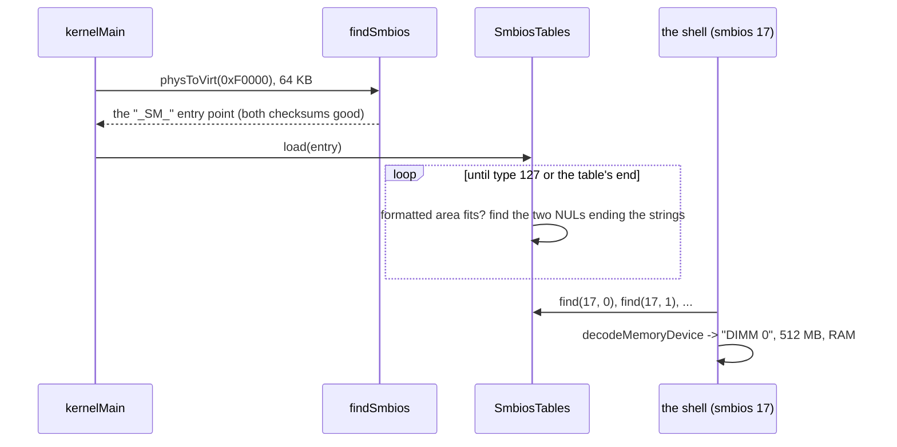

# SMBIOS (`kernel/firmware/smbios/`)

What the firmware knows about the machine as a product: who made the board
and the BIOS, the model and serial number, the processor sockets, the memory
slots and the modules in them. The firmware writes it into the **SMBIOS**
table (also called DMI). This directory finds the table, walks its
structures and decodes the common ones; the shell's `smbios` shows them,
like `dmidecode` on Linux.

```
atlOS:/> smbios
SMBIOS 2.8, 9 structures in 380 bytes at 0xf5a20
  handle  type  length  strings  name
  0x0000     0      24        3  BIOS
  0x0100     1      27        3  System
  0x0300     3      22        2  Chassis
  0x0400     4      42        3  Processor
  0x1000    16      23        0  Physical memory array
  0x1100    17      40        2  Memory device
  0x1300    19      31        0  Memory array mapped address
  0x2000    32      11        0  System boot
  0x7f00   127       4        0  End of table
```

## What is it for?

ACPI (`../acpi/`) describes what the kernel needs to *run* the machine:
interrupt controllers, timers, power. SMBIOS describes what a person or an
inventory tool wants to *know*: "a Dell OptiPlex 7090, BIOS 1.18.0, two 8 GB
DDR4 3200 modules in DIMM 1 and DIMM 3". The kernel does not need it to boot.
It is useful for reports, for working around a known firmware bug of one
board model, and for learning what is in the machine.

### The entry point

On a BIOS machine the firmware puts an **entry point** on a 16 byte boundary
between `0xF0000` and `0xFFFFF`. It starts with the anchor `"_SM_"`:

```
offset 0x00  "_SM_"   checksum   length (0x1F)   major.minor version   max structure size
       0x10  "_DMI_"  checksum   table length   table address (32 bit)   structure count
```

Two checksums: all `length` bytes add up to 0, and so do the 15 bytes from
`"_DMI_"` (the older DMI entry point, kept inside it). SMBIOS 3.0 has another
entry point, `"_SM3_"`, with a 64 bit table address; on UEFI machines the
firmware gives its address in the UEFI configuration table instead.

### Structures

The table is a list of structures, one after the other:

```
type (1 byte)  length (1)  handle (2)  fields of the type ...  | strings: "QEMU\0" "Standard PC\0" "\0"
\____________________ the formatted area: length bytes ______/
```

- The **type** says what it describes: 0 BIOS, 1 system, 2 baseboard,
  3 chassis, 4 processor, 17 memory device, 127 the end of the table, 128
  and above vendor specific.
- The **length** covers the formatted area only. Each SMBIOS version added
  fields at the end, so a structure from an older firmware is shorter: a field
  beyond `length` is simply not there.
- The **handle** names the structure; other structures refer to it (a memory
  device points at its memory array).
- Text is not in the formatted area. A field holds a **string number**
  (1, 2, ...; 0 means "no string") and the strings follow the formatted area,
  each ended by a NUL, the set ended by another NUL. A structure without
  strings ends with two NULs.

So the length of a structure is only known after walking its strings, and the
next structure starts after the two NULs.

## How could it be designed?

| Question | Options |
|---|---|
| Finding the entry point | **scan `0xF0000..0xFFFFF`** (BIOS) · the UEFI configuration table (UEFI) · a boot loader's copy (the multiboot2 SMBIOS tag; GRUB does not provide it) · `/sys/firmware/dmi/tables` (Linux user space) |
| Versions | **2.x (`_SM_`)** · 3.x (`_SM3_`, 64 bit, no structure count) · both |
| Walking | **one walker for every structure, bounded by the table length** · one parser per type, in a fixed order |
| Fields | **a decode function per type into a plain struct, fields beyond `length` read as 0** · packed structs laid over the bytes (wrong for short structures) · a generic table of field descriptions (dmidecode) |

## How atlOS does it

- **`findSmbios(area, size, seenVersion3)`** (`smbios.cpp`): `kernelMain`
  hands it `0xF0000..0xFFFFF` through the physmap. It checks every 16 byte
  boundary with `smbiosEntryIsValid` (both anchors, both checksums, a length
  of `0x1F`, or `0x1E` from firmware that followed an error in the 2.1
  spec). Only 2.x is read: a `"_SM3_"` is noted (the boot log says so) and
  nothing is parsed from it.
- **`SmbiosTables::load(entry)`** checks the entry point again and walks the
  table through the physmap: per structure it checks that the formatted area
  fits, finds the two NULs that end the strings, and stops at type 127 or the
  table's end. A structure that runs past the table ends the walk there and
  sets `truncated()`; the ones before it stay listed. Up to 128 structures.
- **`SmbiosStructure`**: the formatted area and the strings of one
  structure. `byte`/`word`/`dword`/`qword(offset)` read little endian fields
  at any alignment and give 0 beyond `length`; `string(n)` gives "" for 0 or
  a number past the last string. `find(type, index)` gives every structure of
  a type in turn (several processors, several memory slots).
- **Decoders**, one file per type, each a plain struct and a
  `decode...(structure, info)` function that refuses another type or a
  structure shorter than the oldest version of its type:
  - `bios_information`: type 0. Vendor, version, release date, ROM size,
    characteristics, the release numbers (2.4).
  - `system_information`: type 1. Manufacturer, product, version, serial
    number, UUID (2.1), SKU and family (2.4).
  - `baseboard_information`: type 2. The board's strings, its features
    and its type.
  - `processor_information`: type 4. Socket, manufacturer, version,
    family, the CPUID signature, speeds, status, serial/part number (2.3) and
    cores and threads (2.5).
  - `memory_device`: type 17. Slot and bank, size (in KB, MB, or the
    extended size of 2.7), type (DDR4, ...), speed (2.3), manufacturer and
    part number, configured speed (2.7).
- The **UUID**'s first three fields are stored little endian since 2.6 and
  big endian before; the shell prints it according to the table's version.

### Deliberately not done

- No SMBIOS 3.x and no UEFI configuration table: on a UEFI machine (or one
  whose firmware has only `_SM3_`) there is no SMBIOS for atlOS. Nothing
  fails: the boot log says so and `smbios` reports it.
- Only types 0, 1, 2, 4 and 17 are decoded. The others are listed with their
  strings and dumped.
- No processor family names (only the number), no characteristics bit
  names, no "family 2" field (family `0xFE`).
- The kernel does not use the data: the processor count and the memory map
  come from ACPI and multiboot, which are meant for that.

## Flow: from the BIOS area to a memory module



## Tests

- *SMBIOS (made up)*: a 2.8 table built byte by byte: the walk (7
  structures, an OEM one without strings), `find` by type and index, strings
  by number (0 and past the last give ""), fields beyond `length` read as 0;
  every decoder, including a processor of the 2.0 length (no core count)
  and memory sizes in KB and through the extended size; entry points with a
  wrong anchor, checksum or `_DMI_` refused; a structure longer than the table
  and strings without their end stop the walk; `findSmbios` only on 16 byte
  boundaries, `_SM3_` seen but not read.
- *SMBIOS on this machine*: QEMU's SeaBIOS table: a BIOS, the system made by
  "QEMU", a populated processor socket, memory devices adding up to the
  512 MB the tests start QEMU with, the end of table last. Skipped without a
  2.x entry point.
- *Shell commands*: `smbios`, `smbios 1`, `smbios 4`, `smbios 17` and errors
  on the made up table. Shell test: `smbios`, `smbios 1` and `smbios 17` on
  QEMU.

## References

- DMTF DSP0134, System Management BIOS (SMBIOS) Reference Specification
  (3.x keeps the 2.x structures): 5.2 the entry points, 6.1 the structure
  format, 7.1 BIOS, 7.2 system, 7.3 baseboard, 7.5 processor, 7.18 memory
  device
- OSDev Wiki: [System Management BIOS](https://wiki.osdev.org/System_Management_BIOS)
- dmidecode (`dmidecode.c`, `dmiopt.c`): how Linux user space decodes every
  type
