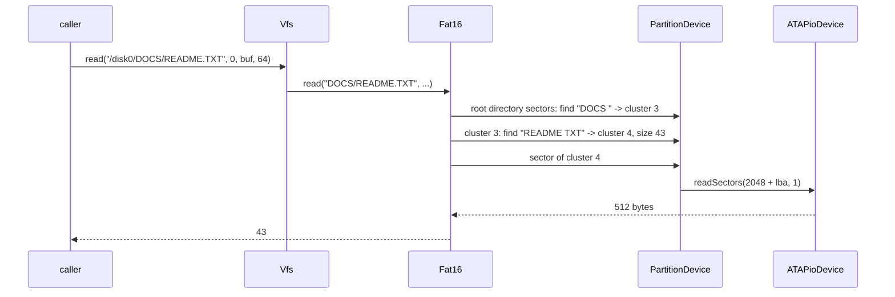
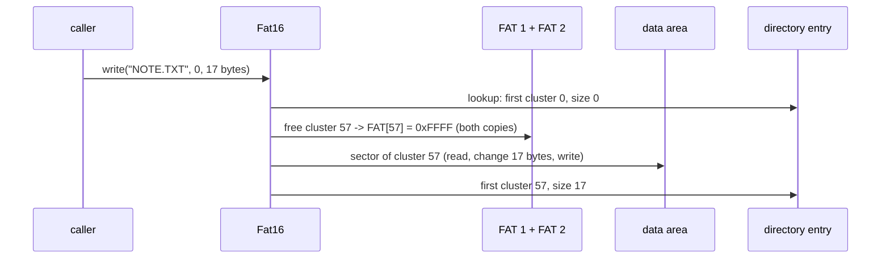

# File systems (`kernel/fs/`)

How "the bytes of `/disk0/DOCS/README.TXT`" become sector reads on a disk.

```
Fs::Vfs              vfs.cpp          /disk0/DOCS/README.TXT -> the disk0 file system, "DOCS/README.TXT"
Fs::FileSystem       file_system.hpp  interface: stat, read, listDirectory, create, write, mkdir, remove, rmdir
Fs::Fat16            fat16.cpp        directory entries, cluster chains -> sector numbers
Drivers::BlockDevice drivers/disk/    PartitionDevice (+ offset) -> ATAPioDevice (I/O ports)
```

`storage.cpp` builds this stack at boot: it probes the ATA drives, reads each
disk's partition table and mounts every FAT16 partition as `/disk0`,
`/disk1`, ... Every disk and partition goes into a `BlockDeviceList`, which
the shell's `disk` command lists and reads sectors from.

## What is it for?

A disk is a long array of 512 byte sectors and nothing more. A **file system**
is the data structure, stored in those sectors, that says which sectors belong
to which named file, how big it is and how names are grouped into directories.
The kernel's file system code reads that structure and turns "offset 1000 of
`README.TXT`" into "sector 27713".

Several disks, partitions and file system types should look like one tree to
the rest of the kernel: that is the job of the **VFS** (virtual file system).

## How could it be designed?

### The file system

| Type | Idea | Notes |
|---|---|---|
| **FAT (12/16/32)** | a table with one entry per cluster: the next cluster of the file, a linked list per file | very simple; every OS, camera and USB stick reads it; no permissions, no journal |
| ext2 | inodes (file metadata + block pointers), block groups, bitmaps | the classic Unix design; permissions, hard links |
| ext4, NTFS, APFS | extents, journaling or copy-on-write, B-trees | crash safe and fast, much more code |

### The VFS interface

| Question | Options |
|---|---|
| How does a caller name a file? | **by path for every call** (`read(path, offset, ...)`) · open once, get a handle (`open` → file descriptor, `read(fd, ...)`) |
| How are file systems combined? | **mount points in one tree** (`/disk0/...`, Unix) · drive letters (`C:\`, DOS) · only one file system |
| What does the VFS know? | **only the interface** · a cache of looked up names (Linux dentry cache) and file metadata (inodes) |

## How atlOS does it

**FAT16 with 8.3 names, read and write.** FAT is the simplest real file
system and tools on every host can create and inspect it (the test disk is
made with mtools, and checked with `fsck.fat` after the kernel wrote to it).
Long file names are left for later.

### FAT16 on disk

```
| boot sector + reserved | FAT 1 | FAT 2 | root directory | data area: cluster 2, 3, 4, ... |
 sector 0                                  fixed size        cluster n starts at
 (sizes: the BPB)                                            firstData + (n - 2) * sectorsPerCluster
```

- **Boot sector** (the BIOS Parameter Block): bytes per sector, sectors per
  cluster, reserved sectors, number of FATs, root directory entries, sectors
  per FAT, total sectors. `Fat16::mount` computes where everything is from
  these and refuses volumes that do not add up.
- **Which FAT?** Only the number of clusters decides: fewer than 4085 is FAT12,
  fewer than 65525 FAT16, more is FAT32 (Microsoft's FAT specification). The
  "FAT16" text in the boot sector is only a label.
- **The FAT**: one 16-bit entry per cluster. A file's directory entry holds its
  first cluster; `FAT[cluster]` is the next one:

```
directory entry "BIG.TXT", first cluster 3, size 1300

FAT:  [3] = 7    [7] = 5    [5] = 0xFFF8 (end of chain)
data: cluster 3 = bytes 0..511, cluster 7 = 512..1023, cluster 5 = 1024..1299
```

  `0x0000` is a free cluster, `0xFFF7` a bad one, `0xFFF8..0xFFFF` the end.
- **Directory entries**: 32 bytes each: an 11 byte name (`README  TXT`: 8 + 3,
  space padded, upper case, no dot), attributes, first cluster, size. The first
  name byte `0x00` ends the directory, `0xE5` marks a deleted entry. Long file
  names are stored as extra entries with attributes `0x0F` before the 8.3
  entry; atlOS skips them. The root directory has a fixed place and size,
  subdirectories are cluster chains like files and start with `.` and `..`.

### Reading `/disk0/DOCS/README.TXT`



### Writing

Every change is a few sector writes; there is no cache, each one goes to the
disk at once.

| Operation | What changes on disk |
|---|---|
| `create("A.TXT")` | a free slot in the parent directory (a deleted entry or the end mark) gets an entry: name, archive attribute, first cluster 0, size 0 |
| `write(path, offset, data)` | missing clusters are allocated (first fit, starting after the last allocation) and linked to the end of the chain in **every FAT copy**; the data sectors (a partly written sector is read first); the entry's size, first cluster and time |
| `makeDirectory("D")` | a zeroed cluster with `.` (itself) and `..` (the parent, 0 for the root); an entry with the directory attribute |
| `remove("A.TXT")` | the entry's first byte becomes `0xE5` (deleted); the chain's FAT entries become 0 (free) |
| `removeDirectory("D")` | the same, only if `D` holds nothing but `.` and `..` |

A full subdirectory gets one more cluster; the root directory has a fixed
size and can not grow (512 entries on the test disk). There are no holes:
`write` starts inside the file or right at its end. When the volume is full,
`write` writes what fits and returns that count.

No clock yet: every entry is dated 1980-01-01 00:00, the FAT epoch.



### Write order (and why it matters)

Writing a file touches three places: the FAT, the data and the directory
entry. If the machine stops between two of those writes, the disk keeps a
state in between. atlOS writes them in the order the code needs them (FAT,
data, entry) and does not try to be crash safe. What a crash can leave:

| Stopped after | State on disk | Effect |
|---|---|---|
| FAT, before the entry | clusters marked used, no entry points at them | **lost clusters**: space wasted until `fsck` frees them |
| `remove`: entry deleted, before the FAT | the chain is still marked used | lost clusters again |
| a FAT copy, before the other | FAT 1 and FAT 2 differ | `fsck` asks which copy to trust |

Other orders and techniques, roughly from simple to robust:

- **Careful order**: allocate and write the data first, update the entry
  last, and free clusters only after the entry is gone. A crash then loses
  at most some space, never points a file at foreign data.
- **Dirty bit**: FAT16 has a "volume was not cleanly unmounted" bit in
  `FAT[1]`; set at mount, cleared at unmount, so the next mount knows to
  check. Needs an unmount.
- **Journaling** (ext3/4, NTFS): write what is about to change to a log
  first, then change it; after a crash the log is replayed. FAT has none.
- **Copy-on-write** (ZFS, Btrfs, APFS): never overwrite, write new blocks and
  switch one pointer at the end.

### Robustness

A file system on a disk is input from outside: it may be damaged or made up.
`Fat16` checks instead of trusting:

- every cluster number in a chain must be a data cluster (2 .. clusters + 1);
  a free, reserved or bad cluster in the middle of a file is an error
- a chain that ends before the file size says is an error
- a directory chain longer than the number of clusters must loop: the walk
  stops there instead of running forever

The self tests build a FAT16 volume by hand in RAM (`MemoryBlockDevice`) with
exactly these defects.

### The VFS

`Fs::Vfs` is a table of up to 8 `(name, FileSystem&)` pairs. A path's first
component picks the file system, the rest goes to it unchanged. `/` itself
lists the mount names. Every call takes a path, there are no open files yet:
nothing has to be closed, and a later `open` can be added on top.

### Deliberately not done

- No long file names (and removing a file that has one leaves its LFN parts
  behind), no FAT12/FAT32, no exFAT, no rename or truncate.
- Not crash safe (see *Write order*), no dirty bit, no real timestamps.
- No open files / file descriptors, no caching: every call walks the path
  again and reads sectors one at a time (the FAT keeps one sector cached).
- No permissions, timestamps or volume labels in the interface.
- The ATA driver polls and uses 28-bit LBA only; no DMA, no AHCI (SATA in
  native mode), no GPT partition tables.

## Tests

`kernel/tests/selftest.cpp`:

- *Block devices and the MBR*: range checks, MBR parsing, partition offsets.
- *FAT16 8.3 names*: name conversion both ways.
- *FAT16 (RAM disk)*: a hand built volume: lookups, reads across clusters
  that are not in order, `..`, listings, the broken chains above, the VFS on
  top, and volumes that are not FAT16.
- *FAT16 writing (RAM disk)*: create, append and overwrite in odd sized
  pieces, files over several clusters, both FAT copies equal, remove gives
  every cluster back, mkdir with `.`/`..`, a directory growing past one
  cluster, rmdir only when empty, a full volume and a full root directory.
- *ATA disk (test disk)*: the real driver and `/disk0` as mounted at boot,
  against the image from `scripts/make-disk-image.sh` (see `tools/disk/`).
  Then the kernel writes `KERNEL/NOTE.TXT` and an 11000 byte
  `KERNEL/DATA.TXT`, and creates and removes a directory with a file. After
  QEMU exits, `scripts/check-test-disk.sh` checks the disk on the host:
  `fsck.fat -n` must find it consistent, and mtools must read what the kernel
  wrote. A second FAT implementation catches what the kernel's own reader
  would not (both sides could share a misunderstanding). Skipped when no disk
  is attached.

## References

- Microsoft: *FAT: General Overview of On-Disk Format* (the FAT32 File System
  Specification, fatgen103)
- OSDev Wiki: [FAT](https://wiki.osdev.org/FAT), [VFS](https://wiki.osdev.org/VFS),
  [MBR (x86)](https://wiki.osdev.org/MBR_(x86)),
  [ATA PIO Mode](https://wiki.osdev.org/ATA_PIO_Mode)
- *Operating Systems: Three Easy Pieces*: "File System Implementation",
  "Files and Directories"
- xv6 book (MIT 6.1810): chapter "File system"
