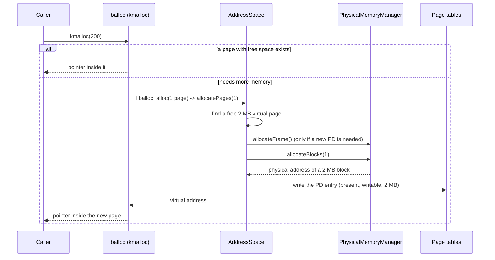
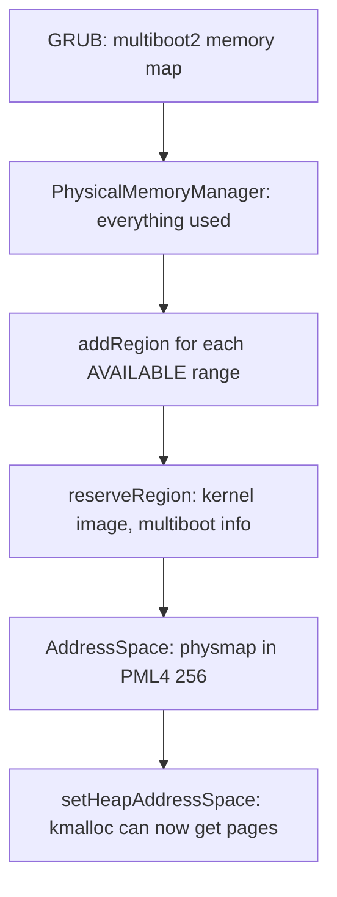

# Memory management (`kernel/mm/`)

Three layers that turn "the RAM the firmware reports" into "memory a kernel
object can use": a physical memory manager, a virtual memory manager and a
heap. Everything else in the kernel allocates through them.

```
kmalloc / kfree / new / delete      heap.hpp, liballoc/   small objects, any size
AddressSpace::allocatePages         vmm.cpp               2 MB virtual pages
PhysicalMemoryManager               pmm.cpp               2 MB physical blocks, 4 KB frames
```

## What is it for?

A CPU in long mode never uses physical addresses directly: every access goes
through the **page tables**, which translate virtual addresses to physical
ones. So there are two separate questions:

1. **Which physical memory is free?** The firmware hands over a memory map
   (via multiboot2): "these ranges are RAM, these are reserved". Some of the
   RAM already holds the kernel. The *physical memory manager* (PMM) keeps
   track of what is free and hands out pieces of it.
2. **Where does that memory appear in the address space?** The *virtual memory
   manager* (VMM) writes page table entries so that a range of virtual
   addresses points at the physical memory the PMM gave out.

On top, kernel code wants `new Thread(...)` of 200 bytes, not "a 2 MB page".
The **heap** cuts pages into small allocations.

## How could it be designed?

### Physical memory

| Approach | How | Plus | Minus | Used by |
|---|---|---|---|---|
| **Bitmap** | one bit per page/block, scan for a 0 | tiny, simple, easy to reserve ranges | allocation scans; slow for huge RAM | many hobby OSes, early Linux |
| Free list | free pages linked through themselves | O(1) alloc/free | needs the memory mapped to write the links; contiguous runs are hard | xv6 (`kalloc`) |
| Stack of free frames | array of free addresses | O(1) | memory for the stack, no contiguity | some hobby OSes |
| Buddy allocator | power-of-two blocks, split and merge | fast, contiguous ranges, little fragmentation | more code | Linux (`page_alloc`) |

### Page size and table access

| Question | Options |
|---|---|
| Page size | 4 KB (fine grained, 4 table levels) · **2 MB** (3 levels, fewer tables) · 1 GB |
| How the kernel edits page tables | identity map them · recursive mapping (a PML4 entry points at the PML4 itself) · temporary window (map one table at a time) · **physmap**: map all physical memory at a fixed offset (Linux, FreeBSD) |
| Page size for user programs | **2 MB like the kernel** (simple, few tables; coarse protection) · 4 KB (fine grained, needed for copy-on-write, `fork`, `mmap`) |

### Heap

| Approach | Plus | Minus |
|---|---|---|
| Bump allocator | 10 lines | never frees |
| Free list (first fit) | simple, frees | fragmentation, O(n) |
| **Third party allocator (liballoc)** | done, tested, frees and merges | someone else's code |
| Slab allocator | fast for fixed sizes | more code (Linux, Solaris) |

## How atlOS does it

**PMM: bitmap of 2 MB blocks** (`pmm.cpp`). The simplest structure that can
also *reserve* arbitrary ranges (the kernel image, the multiboot info). One
bit per 2 MB block; 16 KB of bitmap covers 256 GB. Allocation is first fit:
scan for `n` zero bits in a row. The bitmap storage is a constructor argument,
so the self tests build managers over a fake 128 MB "machine".

- `Memory::populateFromMultiboot` (`memory.cpp`) frees the `AVAILABLE`
  regions, then reserves `0 .. kernel_physical_end` (the firmware reports the
  kernel's memory as available too; without the reservation the PMM would
  hand out the kernel's own pages).
- Block 0 is never handed out, its address would read as `nullptr`.
- Page tables are 4 KB, a whole 2 MB block for each would waste 2044 KB. So
  the PMM also hands out **4 KB frames**, cut from 2 MB blocks ("frame pools").

**VMM: 2 MB pages + a physmap** (`vmm.cpp`). With 2 MB pages there are only
three table levels (PML4 → PDPT → PD) and far fewer tables to manage; user
programs use 2 MB pages too.

To *edit* a table the kernel needs a virtual address for it, but entries hold
*physical* addresses. The **physmap** solves that once: all physical memory
(up to 64 GB) is mapped at `physmapBase` (`0xFFFF800000000000`, `PML4[256]`),
so the table at physical `p` is at `physmapBase + p`, whichever address space
it belongs to and whether it is loaded or not. Its own 64 page directories
live in the kernel image (`.bss`, 256 KB): they have to exist before the
physmap does.

Every address space has the same layout:

```
PML4[0]        identity map of the first megabytes (boot)    kernel only, shared
PML4[1..255]   user programs: userBase 0x0000008000000000     per address space
PML4[256]      physmap: physical memory at 0xFFFF800000000000 shared
PML4[511]      kernel image, heap, thread stacks (-2 GB)       shared
```

A new address space copies the kernel's entries 0 and 256..511, so they point
at the same PDPTs: a kernel page mapped later shows up everywhere. That is
also why the kernel half can not get a new PDPT later (it would exist in one
address space only); the two it needs are there from boot.

`Memory::AddressSpace` holds just the physical address of its PML4:

- `AddressSpace(pmm)` is the kernel's: it takes over boot.S's tables and
  builds the physmap. `AddressSpace(pmm, kernel)` is a new, empty one for a
  user program; `activate()` loads it into CR3.
- Kernel pages: `allocatePages(n)` finds `n` free virtual pages above the
  kernel image and backs each with a PMM block; `mapPhysical` maps a given
  physical page (MMIO) without the PMM.
- User pages: `allocateAt(virt, n, flags)` maps zeroed blocks in the user
  range, `Writable` and `User` (ring 3) as asked; the tables above get the
  user bit, the PD entry decides. `isUserAccessible(virt, size, write)` is
  what system calls check user pointers with.
- An unused bit of the entry (bit 9) marks pages whose block the address
  space owns: unmapping or destroying it gives those back, never a
  `mapPhysical` page. The destructor also frees its PDs and PDPTs.
- `translate(virt, phys)` walks the tables without faulting and
  `forEachMapping` reports every mapped page; `walk(virt, steps)` returns
  every entry it reads on the way (the shell's `pt`); the shell's `md`, `mw`
  and `vmmap` use them.

#### Physmap or recursive mapping

A common alternative is a recursive slot: one PML4 entry points back at the
PML4 itself, so addresses through that slot land on the tables (with slot
510, `[510][510][i][j]` is the PD for `(i, j)`). It needs no memory and no
mapping of physical memory, but it only shows the tables loaded in CR3: to
build a second address space for a program the kernel would switch CR3 to it
(and back) for every edit, or point a second recursive slot at the other
PML4. The physmap costs 256 KB of tables and makes every table, of every
address space, one addition away; atlOS needs exactly that for user
programs.

**Heap: liballoc 1.1.** Writing a good general allocator is a project of its
own; liballoc is small, public domain and needs only four hooks
(`liballoc_hooks.cpp`). Those hooks are C functions without an object, so
`kernelMain` binds the kernel `AddressSpace` once
(`Memory::setHeapAddressSpace`). A boundary global, see `docs/style.md`.

### Deliberately not done

- No 4 KB pages: user programs use 2 MB pages as well, so even a tiny program
  takes a few MB (code, data and stack need separate pages: protection is per
  page). 4 KB come with copy-on-write, `fork` or `mmap`.
- The physmap covers 64 GB; the PMM manages no more than that.
- No NX (no-execute) bit yet; no `PCID`, so a CR3 switch flushes the TLB.
- No buddy allocator, no NUMA, no swapping, no copy-on-write.
- The PMM scan is linear; with 256 blocks (512 MB) nobody notices.

## Flow: `new Thread(...)` down to a page table entry



## Boot: from the memory map to a working heap



## Tests

`kernel/tests/selftest.cpp`:

- *PMM blocks / frames (isolated)*: a 64 block manager: regions, reservations,
  exhaustion, double frees, first fit, frame pools and their limit.
- *PMM from a multiboot memory map*: a hand built multiboot2 structure.
- *VMM*: allocate, write, free, translate, map the same physical page twice.
- *VMM translate and mappings*: the physmap, physical 0 vs unmapped, the
  mapping list.
- *Address spaces*: a second one shares the kernel half and the identity
  map, user pages only in the user range, zeroed, built while inactive and
  seen after `activate()`, flags, everything given back by the destructor.
- *Heap*: sizes from 1 byte to 3 MB, `krealloc`, `kcalloc`.

## References

- OSDev Wiki: [Paging](https://wiki.osdev.org/Paging),
  [Page Frame Allocation](https://wiki.osdev.org/Page_Frame_Allocation),
  [Detecting Memory (x86)](https://wiki.osdev.org/Detecting_Memory_(x86)),
  [Higher Half Kernel](https://wiki.osdev.org/Higher_Half_Kernel)
- Intel SDM Vol. 3A, chapter "Paging" (4-level paging, PS bit for 2 MB pages)
- *Operating Systems: Three Easy Pieces*: "Paging: Introduction", "Free-Space Management"
- xv6 book (MIT 6.1810): chapter "Page tables"
- [liballoc](https://github.com/blanham/liballoc)
