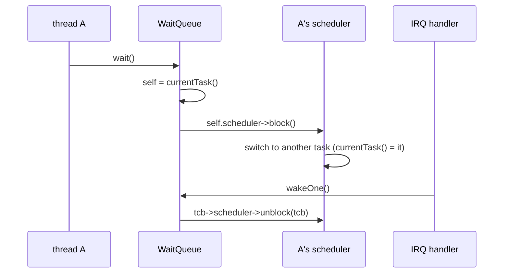
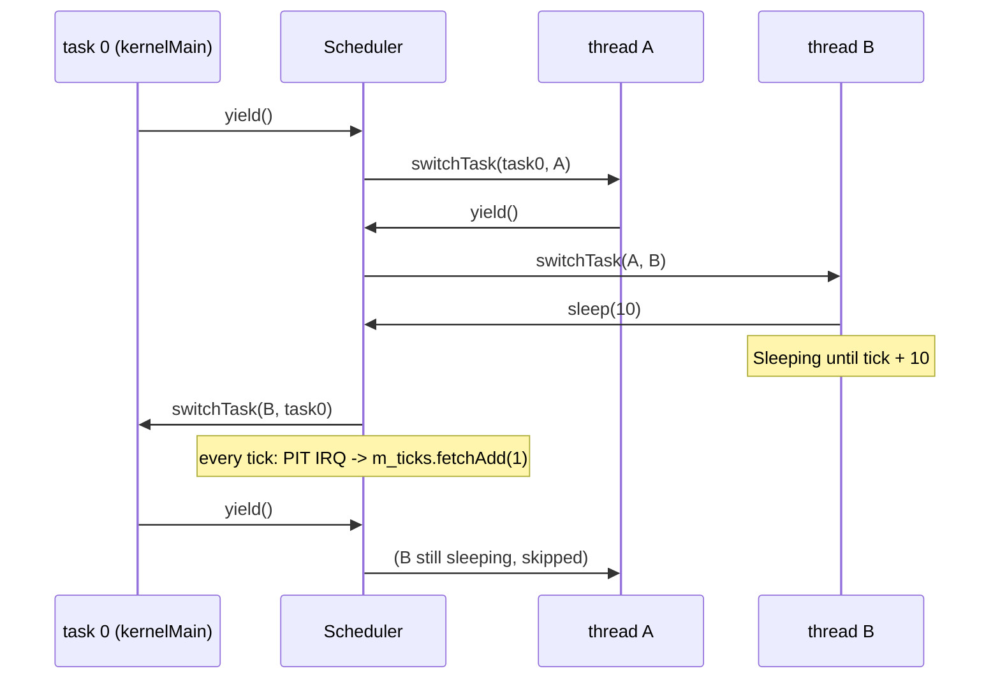
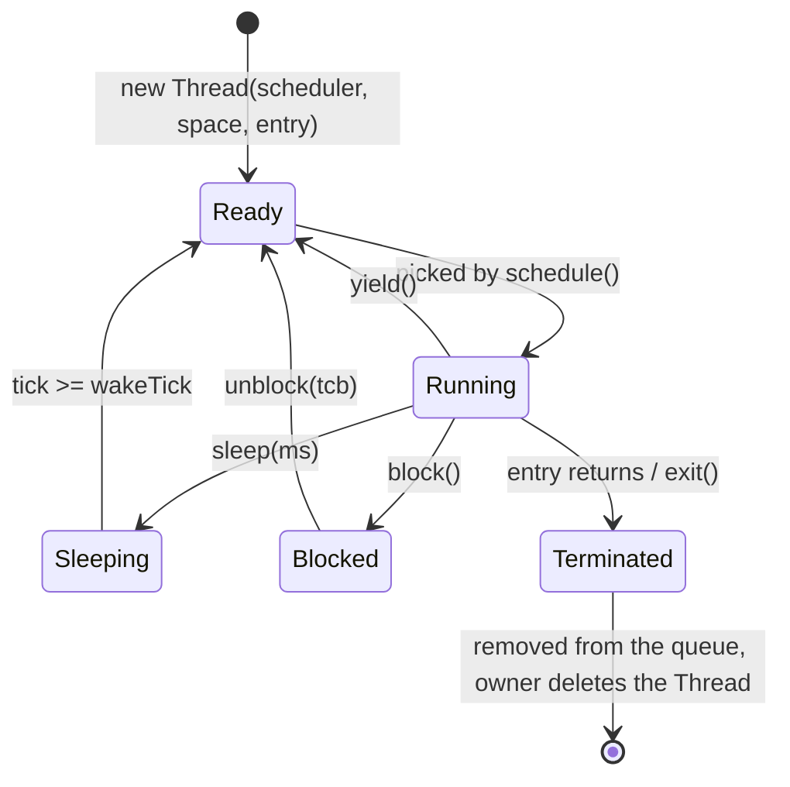

# Scheduler and threads (`kernel/sched/`)

`Threading::Thread` is a flow of execution with its own stack and saved
registers; `Threading::Scheduler` decides which thread runs on the CPU and
switches between them. atlOS has one CPU and a **cooperative** scheduler.

## What is it for?

A CPU runs one instruction stream at a time. To let several activities make
progress (a shell, a disk driver waiting for data, a timer job) the kernel
keeps each one's state — registers, stack pointer, where it stopped — in a
*thread control block* (TCB) and switches the CPU from one TCB to another. That
switch is the **context switch**; choosing who runs next is **scheduling**.

The big question is *when* a switch happens.

## How could it be designed?

| Model | When does a thread give up the CPU | Plus | Minus | Used by |
|---|---|---|---|---|
| **Cooperative** | only when it calls `yield`, `sleep`, `block` or ends | simple; no locks needed between threads; switches only at known points | one thread that never yields freezes everything | classic Mac OS, Windows 3.x, many embedded/RTOS loops, coroutines |
| Preemptive | also when the timer interrupt says its time slice is over | a busy thread can not starve others; needed for untrusted (user) code | every shared structure needs locking; switches can happen anywhere | Linux, Windows NT, xv6 |

Choosing the next thread:

| Policy | Idea |
|---|---|
| **Round robin** | everyone in turn |
| Priorities | higher priority first (risk: starvation) |
| Multilevel feedback queue | priorities that adapt to behavior |
| CFS (Linux) | fair share of CPU time, red-black tree by "virtual runtime" |

Where the thread list lives: a fixed array, a linked list through the TCBs,
per-CPU run queues (SMP).

## How atlOS does it

**Cooperative round robin over a fixed array.** It is the smallest scheduler
that still shows every essential piece (TCB, context switch, states, sleeping,
blocking). Because a thread only loses the CPU where it calls the scheduler,
kernel code needs no locks against other threads; the price is that every
thread must cooperate.

- `Scheduler(TickSource&)` (`scheduler.hpp`): the flow that constructs it
  becomes **task 0** (it has a TCB but no `Thread` object; for the kernel's
  scheduler that is `kernelMain`). The timer (the PIT) only counts ticks; it
  never switches threads.
- Run queue: `TCB* m_readyQueue[16]`. `schedule()` looks at the entries after
  the current one and switches to the first runnable one.
- States: `Ready`, `Running` (runnable) and `Sleeping` (until `wakeTick`),
  `Blocked` (until `unblock`), `Terminated` (skipped, then dequeued).
- Nothing runnable → `sti; hlt`: the CPU sleeps until an interrupt (e.g. a
  timer tick that wakes a sleeper). If the caller had interrupts off (a
  thread waiting under a `Sync::InterruptGuard`), they are turned off again
  before it continues.
- Each TCB has a name (`kernel` for task 0, `t0`, `t1`, ... for threads, the
  file name for a user program's thread), its stack range, and an `owner`
  (the user program, if any).
- On every switch the scheduler puts the next thread's stack top into the
  TSS (`rsp0`): interrupts and system calls from ring 3 use it. The saved
  `cr3` switches the address space with the thread.
- Waiting for an event (not a time) goes through `kernel/sync/`: a
  `WaitQueue` blocks threads and `unblock`s them, see `sync/README.md`.
- **The current task** (`Threading::currentTask()`): the TCB running now. Each
  switch sets it, each TCB knows its scheduler (`tcb.scheduler`). Code finds
  "this thread" and its scheduler from it instead of being handed a
  scheduler: `Threading::yield()`, `sleep(ms)`, `exitThread()`, the sync
  objects, `Thread(entry)`, the system calls. There is still no global
  scheduler: several can exist (the self tests build their own on a fake tick
  source), and the current task says which one runs. See *The current task*
  below.
- Each `Thread` gets a 2 MB stack page from the `AddressSpace` it is given;
  the initial stack is laid out like "just after a `call`", as the System V ABI
  requires (`rsp % 16 == 8` on entry). Its `rbp` starts at 0, which ends a
  panic backtrace at the top of the thread.

### The context switch (`arch/x86_64/cpu/context.S`)

`switchTask(from, to)` stores every general purpose register, `rflags`, `rsp`,
the return address and `cr3` into `from->regs`, loads the same from
`to->regs`, pushes the saved `rip` on the new stack and `ret`s into it. A new
thread's saved `rip` is `ThreadImpl::threadStartPoint` with the `ThreadImpl*`
in `rdi`, so its first "return" starts it.

### Deliberately not done

- No preemption. User mode will probably need it: a user program
  that never yields would freeze the system.
- No priorities, no time accounting, no SMP (one run queue per CPU later).
- The context switch saves *all* registers; the System V ABI would allow
  saving only the callee-saved ones (`rbx`, `rbp`, `r12`–`r15`). Saving all is
  easier to reason about.
- No SIMD state is saved (the kernel is built without SSE).

## The current task

Code that blocks or wakes a thread (a wait queue, a semaphore, a mutex, a
new thread, a system call) needs two things: **the thread that is running
now** (to block it) and **the scheduler of a given thread** (to make it
runnable again). Most kernels keep exactly that: Linux has `current`, xv6 has
`myproc()`. In atlOS:

```
currentTask()        TCB of the running task          set by Scheduler::switchTo
tcb.scheduler        the scheduler that runs a TCB    set by addTask (task 0: the constructor)
currentScheduler()   currentTask().scheduler
```



So a `Semaphore`, `Mutex` or `ConditionVariable` is a plain value
(`Semaphore sem(0, 1);`) and one object works for threads of any scheduler;
`Thread(entry)` goes to the caller's scheduler.

It is a **boundary global** (`docs/style.md`): one CPU runs one task at a
time, so "the current task" is a fact about the CPU. With several CPUs it is
one value per CPU (read through `gs`).

Schedulers nest: a scheduler constructed by a flow makes that flow its
task 0, so `currentTask()` is its boot TCB from then on; its destructor gives
the previous task back. The self tests build schedulers this way inside the
kernel's task 0.

## Flow: two threads yielding



## Thread states



## Tests

`kernel/tests/selftest.cpp`: *Scheduler round robin / sleep (fake ticks) /
block / remove (isolated)* run on their own schedulers with a `FakeTickSource`,
so sleeping is checked tick by tick; *Scheduler sleep (kernel, PIT)* uses real
time; *Thread stack* checks the ABI alignment and that the stack page is
freed.

## References

- OSDev Wiki: [Cooperative Multitasking](https://wiki.osdev.org/Cooperative_Multitasking),
  [Context Switching](https://wiki.osdev.org/Context_Switching),
  [Scheduling Algorithms](https://wiki.osdev.org/Scheduling_Algorithms)
- *Operating Systems: Three Easy Pieces*: "Limited Direct Execution",
  "Scheduling: Introduction", "Scheduling: The Multi-Level Feedback Queue"
- xv6 book (MIT 6.1810): chapter "Scheduling"
- System V AMD64 ABI: stack alignment and callee-saved registers
