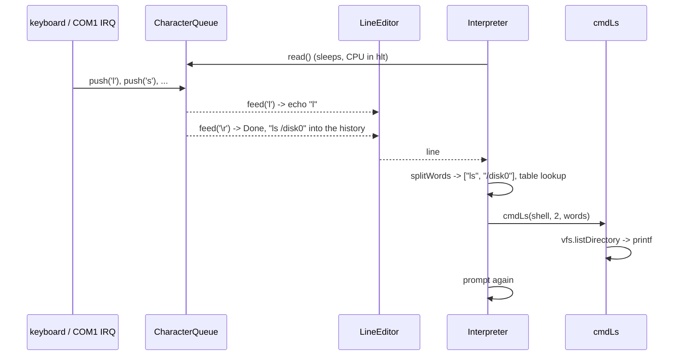

# The kernel shell (`kernel/shell/`)

A command line inside the kernel: type `ls /disk0`, `md 0xb8000 64` or
`tasks` on the keyboard or a serial terminal, and the kernel answers. It runs
in the boot flow (task 0) once everything is set up. When it starts it clears
the screen (the serial log keeps the boot messages) and prints the banner,
the version, the free memory and the mounted disks. Every line it prints fits
80 columns, the VGA screen's width.

```
atlOS:/disk0> help
  ls [dir]                     list a directory
  md addr [len]                memory dump (hex and text), len up to 4096
  ...
```

## What is it for?

A shell turns text into actions: it reads a line, splits it into words, finds
the command named by the first word and runs it with the rest. In a normal OS
it is a user program that starts other programs (`fork` + `exec` in Unix).
atlOS has no user mode yet, so its shell is part of the kernel and its
commands are kernel functions. That makes it a tool for looking inside the
running kernel: memory, page tables, tasks, files.

## How could it be designed?

| Question | Options |
|---|---|
| Where does it run? | **in the kernel** (debug consoles, early OSes, many embedded systems) · a user program (sh, bash, cmd.exe) |
| How are commands found? | **a table of (name, function)** · a class per command behind an interface · programs on disk (`/bin/ls`) |
| Line editing | none (the terminal's cooked mode does it) · **backspace + history** · full editing (readline: cursor movement, completion) |
| Input | **one queue fed by every input device** · one shell per device |

## How atlOS does it

```
keyboard IRQ ─┐                                        ┌─> VGA text screen
              ├─> CharacterQueue ─> LineEditor ─> Interpreter ─> printf ─> TeeSink
COM1 IRQ    ──┘   (semaphore)       (echo, history)  (commands)            └─> COM1
```

- **Input** (`drivers/character_queue.hpp`): the keyboard and the serial
  port's IRQ handlers push into one `CharacterQueue`; its semaphore lets the
  shell sleep in `read()` until a key arrives (see `kernel/sync/README.md`).
  The keyboard driver turns the arrow keys into the ANSI sequences a serial
  terminal sends (`ESC [ A` for up), so both inputs look the same.
- **Output**: `printf` goes to the console; with a COM1 present the console is
  a `TeeSink` that writes to the screen and the serial port. The serial port
  turns `"\n"` into `"\r\n"`, what terminals expect.
- **`LineEditor`** (`line_editor.cpp`): echoes printable characters, handles
  Backspace (`\b` or DEL 0x7F), Enter (`\r`, `\n`, or `\r\n` as one),
  Ctrl+C (drop the line) and Up/Down (a 16 line history). Erasing on screen
  is "back, space, back" (`\b \b`), which works on the VGA console and on
  terminals alike.
- **`splitWords`** (`parser.cpp`): words are separated by spaces or tabs,
  `"double quotes"` keep spaces; changes the line in place, no allocation.
  `parseNumber` reads `0x...` hex or decimal.
- **`Interpreter`** (`interpreter.cpp`): the prompt loop, the current
  directory (`resolvePath` makes paths absolute and resolves `.` and `..`),
  and the dispatch through the command table.
- **Commands** (`commands.cpp`): one function per command,
  `void(Interpreter&, int argc, char** argv)`, listed in one table; `help`
  prints the table. What the commands work on (PMM, address space,
  scheduler, VFS) comes in a `Context` from `kernelMain`; no globals.

### The commands

| Group | Commands |
|---|---|
| general | `help`, `clear`, `echo [words] [> \| >> file]`, `version`, `uptime` |
| files | `pwd`, `cd`, `ls`, `cat`, `touch`, `mkdir`, `rm`, `rmdir`, `mount` |
| memory | `mem`, `md addr [len]`, `mw addr value [1\|2\|4\|8]`, `vmmap` |
| system | `run program.elf`, `tasks` / `ps`, `cpuinfo`, `panic [message]`, `fault`, `reboot` |
| hardware | `cr`, `rdmsr msr`, `wrmsr msr value`, `in port [b\|w\|l]`, `out port value [b\|w\|l]`, `gdt`, `idt [vector]`, `pt addr`, `irq` |

### Looking at memory safely

`md` and `mw` take any virtual address. Reading an unmapped one would page
fault and halt the kernel, so they first ask the page tables
(`AddressSpace::translate`, one check per 4 KB page) and refuse with
`not mapped`:

```
atlOS:/> md 0x7000 32
0000000000007000  41 00 00 00 00 00 00 00  88 77 66 55 44 33 22 11  |A........wfUD3".|
atlOS:/> md 0xdead0000
0x00000000dead0000: not mapped
```

`translate` differs from `virtToPhys` in one way: "not mapped" is not
confused with "mapped at physical 0" (the first megabytes are identity
mapped). Physical memory itself can be looked at through the physmap:
`md 0xffff800000007000` shows physical address `0x7000`.

`vmmap` walks the active tables (`AddressSpace::forEachMapping`) and joins
neighbouring pages with the same flags into one line:

```
  virtual                           physical     size access    pages
  0000000000000000-0000000000e00000 0000000000  14 MB rw kernel 7x2M        identity map of boot
  ffff800000000000-ffff801000000000 0000000000  64 GB rw kernel 32768x2M    the physmap
  ffffffff80000000-ffffffff80e00000 0000000000  14 MB rw kernel 7x2M        the higher half kernel
```

`mw` writes 1, 2, 4 or 8 bytes. It is a sharp tool: writing over kernel data
or page tables breaks the kernel. `0x7000` (low memory the PMM never hands
out) or `0xb8000` (the VGA text buffer: a character appears top left) are
harmless places to try.

`tasks` lists the scheduler's queue: name, state, time left for sleepers,
the stack, and `rsp` (for the running task: the current frame).

### Looking at the hardware

The shell runs in ring 0 and can reach everything the CPU has:

```
atlOS:/> cr
  cr0   0x0000000080000011  PE ET PG
  cr3   0x0000000000408000  the PML4 (physical)
  cr4   0x0000000000000030  PSE PAE
  efer  0x0000000000000500  LME LMA
atlOS:/> pt 0xffffffff80400000
  PML4[511]  = 0x000000000040a023  P W A
  PDPT[510]  = 0x000000000040b023  P W A
  PD[2]      = 0x00000000004000a3  P W A PS
  2 MB page, physical 0x400000
atlOS:/> irq
  vec  count       what
   32  16545       IRQ 0 timer
   36  14          IRQ 4 COM1
```

- `cr` decodes CR0, CR4 and EFER bit by bit; CR2 holds the last page fault
  address, CR3 the active PML4.
- `pt addr` walks the active tables for one address (`AddressSpace::walk`)
  and names the bits of every entry it reads (P, W, U, A, D, PS, G, NX and
  atlOS's `owned`).
- `gdt` reads the GDT through `sgdt` and decodes code, data and the TSS
  descriptor (two slots in long mode); `idt` shows the gates of the
  exceptions, the PIC IRQs and the system call (handler, interrupt or trap
  gate, DPL, IST), `idt n` any one.
- `in` and `out` reach any I/O port, a byte by default (`w` 16, `l` 32 bit):
  `in 0x21` is the PIC's interrupt mask, `in 0x64` the keyboard controller's
  status. Writing to a port changes the device: `out 0x80 0x42` is harmless
  (the POST code port), others are not.
- `rdmsr` and `wrmsr` reach the model specific registers. An MSR the CPU
  does not have raises #GP on a real CPU; the exception table (see
  `kernel/arch/x86_64/idt/README.md`) turns that into "not readable", the
  kernel goes on. QEMU's emulator returns 0 for MSRs it does not know.
- `irq` counts what arrived on every vector since boot: timer ticks,
  keyboard and serial interrupts, system calls, faults.

### Deliberately not done

- No pipes, no general redirection: only `echo` writes to files (`>`, `>>`),
  and `>` removes and recreates the file (there is no truncate yet).
- No cursor movement inside the line (left/right are ignored), no tab
  completion, no scrolling back.
- No programs: commands are compiled into the kernel.
- A command that hangs hangs the shell: nothing preempts it.

## Flow: one command



## Tests

- Self tests (`kernel/tests/selftest.cpp`): *Shell parser* (spaces, quotes,
  limits, numbers and overflow), *Shell line editor* (echo, Backspace, DEL,
  `\r\n`, Ctrl+C, skipped escape sequences, history order, duplicates, a
  full history, the length limit), *Shell commands* (every command against a
  FAT16 volume in RAM with the output captured: paths, files, `echo >`/`>>`,
  `md`/`mw` on a buffer of the test, refusing unmapped memory, `tasks` with a
  sleeping thread), *VMM translate and mappings*.
- End to end (`scripts/run-shelltest.py`, `scripts/build.sh shelltest`, CI):
  boots the normal kernel with COM1 on a TCP socket and types commands the
  way a terminal does (`\r`, DEL, `ESC [ A`, Ctrl+C), checking the answers,
  and finally `fault`, whose page fault report must appear.

## References

- *Operating Systems: Three Easy Pieces*: "Interlude: Process API" (what a
  real shell does with `fork`, `exec`, `wait`)
- ECMA-48 / VT100: the escape sequences (`ESC [ A`, `ESC [ 2 J`)
- OSDev Wiki: [Creating A Shell](https://wiki.osdev.org/Creating_A_Shell),
  [Terminals](https://wiki.osdev.org/Terminals)
- xv6: `user/sh.c` (a small Unix shell with pipes and redirection)
