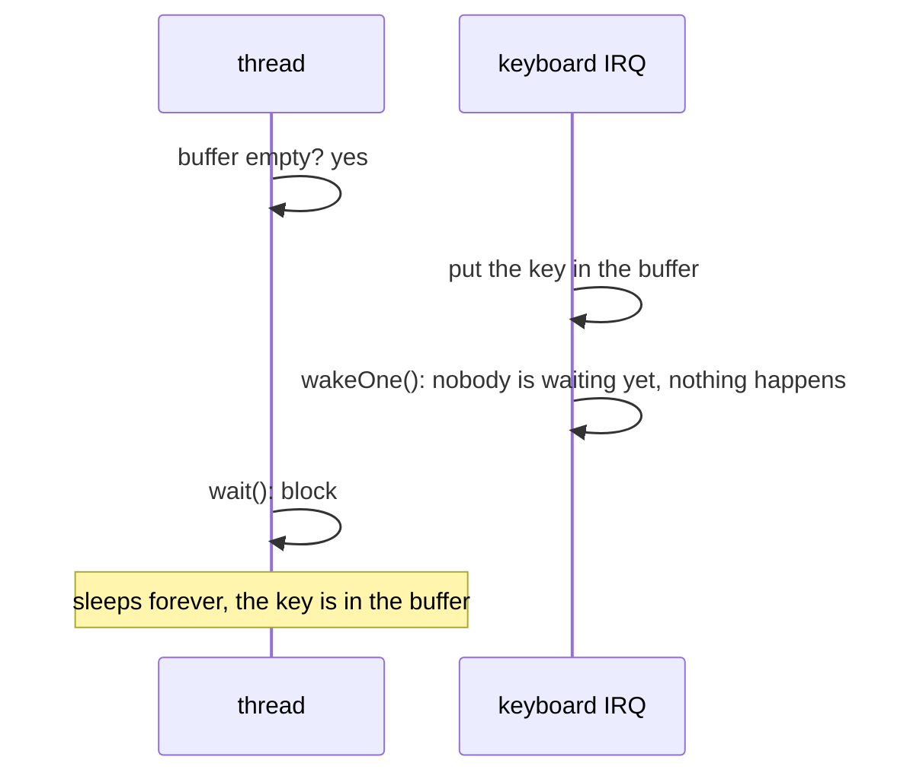
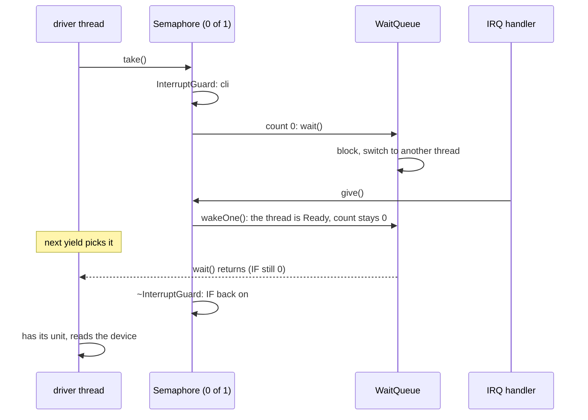

# Synchronization (`kernel/sync/`)

Tools for code that shares data with other code running "at the same time",
and for threads that wait for something without burning the CPU.

| Type | What for | From an interrupt handler? |
|---|---|---|
| `Atomic<T>` | a single value read and written in one indivisible step | yes |
| `InterruptGuard` | a few steps that an interrupt handler must not see half done | yes |
| `WaitQueue` | threads sleeping until someone wakes them (FIFO) | `wakeOne`/`wakeAll` only |
| `Semaphore` | counting units: `take` waits for one, `give` returns one | `give` and `tryTake` only |
| `Mutex` | one owner at a time for a section that waits inside | no |
| `ConditionVariable` | wait until a condition, protected by a `Mutex`, may be true | no |
| `Spinlock` | busy waiting lock for several CPUs (later: SMP) | with interrupts off |

## What is it for?

Two problems, often mixed up:

1. **Mutual exclusion.** Two flows of execution update the same data and one
   of them sees it half done. `count++` is three instructions (load, add,
   store); if something else runs between the load and the store, one of
   the increments is lost.
2. **Waiting.** A thread needs something that is not there yet (a key press, a
   disk block, an item in a buffer). Polling in a loop wastes the CPU; the
   thread should *sleep* and be woken by whoever makes it available.

### Who can run "at the same time" in atlOS?

That depends on the scheduler and the number of CPUs:

| Setup | Can run in the middle of your code |
|---|---|
| **one CPU, cooperative scheduler (atlOS today)** | **only interrupt handlers**; other threads only where you yield, sleep or wait |
| one CPU, preemptive scheduler | interrupt handlers and *any* other thread (the timer may switch at any instruction) |
| several CPUs (SMP) | all of the above, plus code on the other CPUs, truly in parallel |

So in atlOS a thread that does not yield needs no lock against other threads
at all. What it needs is protection against **interrupt handlers**, and a way
to **wait**.

## The lost wakeup

The classic bug when a thread waits for an interrupt:



The check and the wait must be **one step** as far as the interrupt is
concerned. On one CPU that means: interrupts off from the check until the
thread is blocked.

```cpp
InterruptGuard guard;      // cli, remembers the old IF
if (buffer.isEmpty())
    waiters.wait();        // block with interrupts still off
// ~InterruptGuard: IF back to what it was
```

Interrupts do not stay off while the thread sleeps: the context switch loads
the next thread's `RFLAGS`, and when nothing can run the scheduler idles in
`sti; hlt`. When this thread runs again it gets its own `RFLAGS` (IF = 0)
back, so the code after `wait()` is still inside the guard. The scheduler
also turns interrupts off again after idling when the caller had them off
(*Scheduler idle keeps the interrupt state* tests this).

## How could it be designed?

| Question | Options |
|---|---|
| Where do waiting threads live? | **a fixed array per wait queue** · a linked list through the TCBs ("intrusive", no limit, a thread is in one queue at a time) · per object lists allocated on the heap |
| Who gets a released semaphore unit or mutex? | **handed directly to the longest waiter** (FIFO, fair, no "stealing") · put back and everyone woken races for it (simpler wake, threads may starve) |
| What does notify do? | **Mesa**: makes a waiter runnable, it checks again later (`while`) · Hoare: the waiter runs at once and the condition is guaranteed (`if` would do) |
| Short critical sections | **interrupts off** (one CPU) · spinlock (SMP) · both (`spin_lock_irqsave` in Linux) |
| Waiting with a timeout | **not yet** · a blocked thread that the timer also wakes, with a "why did I wake" result |

## How atlOS does it

- **No scheduler handed in**: `Semaphore sem(0, 1);`, `Mutex m;`,
  `ConditionVariable cv;`. `WaitQueue::wait()` blocks the running task
  (`Threading::currentTask()`) on its own scheduler; `wakeOne()` makes a
  waiter runnable on *its* scheduler (`tcb->scheduler`). So one object works
  across schedulers, and can be a global or a member of anything (see
  `kernel/sched/README.md`, *The current task*).
- `Atomic<T>` (`atomic.hpp`): `load`, `store`, `exchange`, `compareExchange`,
  `fetchAdd`, `fetchSub` over the `__atomic` builtins, always sequentially
  consistent. 1 to 8 bytes (16 byte atomics need `cmpxchg16b`, not needed).
  The scheduler's tick counter is one: the timer IRQ adds, threads read.
- `InterruptGuard` (`interrupt_guard.hpp`): `cli` in the constructor, restore
  IF in the destructor. Nests.
- `WaitQueue` (`wait_queue.cpp`): a ring buffer of `TCB*` with the
  scheduler's capacity (16). `wait()` appends the current thread and
  `block()`s; `wakeOne()` takes the oldest and `unblock()`s it (just a state
  change, no switch, so it is fine in an interrupt handler). Destroying a
  queue with waiters panics.
- `Semaphore(initial, max)` (`semaphore.cpp`): counting, `max = 1` is a
  binary semaphore. `take()` waits at 0, `tryTake()` never waits. `give()`
  hands the unit to the oldest waiter if there is one (the count stays 0),
  else adds to the count; at `max` it returns `false` instead of panicking,
  so an interrupt handler can call it blindly.
- `Mutex` (`mutex.cpp`): an owner `TCB*` and a `WaitQueue`. `lock` twice
  from the same thread or `unlock` by a non-owner panics. `unlock` makes the
  oldest waiter the owner before waking it. No `InterruptGuard` inside:
  interrupt handlers never use a mutex, and between threads nothing happens
  without a yield.
- `ConditionVariable` (`condition_variable.cpp`): `wait(mutex)` = unlock,
  wait, lock. "Unlock and sleep" must be atomic or a notify can fall in
  between; cooperative scheduling gives that for free, because `unlock` only
  marks the next owner runnable and nothing runs before `wait` blocks.
  `notifyOne`, `notifyAll`. Mesa semantics: wait in a `while`.
- `Spinlock` (`spinlock.cpp`): `compareExchange` loop with `pause`. Not used
  yet; kept for SMP.

### Do we even need a mutex here?

Rarely. Without preemption, a critical section that never yields is already
exclusive. A mutex is for sections that *wait in the middle*: a file system
holding a half updated directory while it waits for the disk interrupt.
Another thread that runs during that wait must not see the directory.

### Why a spinlock is dangerous on one CPU

A spinlock waits by looping until the holder releases it. On one CPU the
holder is not running while you spin, so:

- an **interrupt handler** that spins on a lock its interrupted thread holds
  loops forever (the thread can not run until the handler returns);
- a thread that **yields or waits while holding** it makes the next thread
  that wants it loop forever (cooperative: nobody takes the CPU away).

With the rules "never wait while holding" and "interrupts off if a handler
takes it too" it works, it just never spins. On SMP the same rules apply,
and then spinning makes sense: the holder runs on another CPU.

### Deliberately not done

- No timeouts (`take(ms)`); a thread waits in one queue, without a timer.
- No priority inheritance (there are no priorities).
- A thread deleted while it waits leaves a dangling pointer in the queue.
- No recursive mutex, no reader/writer lock.

## Flow: a semaphore between an IRQ and a thread



## Tests

`kernel/tests/selftest.cpp`, on schedulers with a fake tick source, so every
step is decided by the test's own `yield()`s:

- *Atomic*, *InterruptGuard* (nesting, restoring), *Spinlock*.
- *WaitQueue*: three waiters wake in FIFO order; `wakeOne` does not switch.
- *Semaphore*: counting and `max`, hand off to a waiter, `give` from
  interrupt context, *producer/consumer* through a 4 slot bounded buffer.
- *Mutex*: two threads that yield while holding it run one after the other;
  `unlock` hands over ownership.
- *ConditionVariable*: a notify without the condition makes the waiter wait
  again; woken waiters need the mutex before `wait` returns.
- *Scheduler idle keeps the interrupt state*: sleeping with interrupts off
  comes back with interrupts off.

## References

- *Operating Systems: Three Easy Pieces*: "Locks", "Condition Variables",
  "Semaphores", "Common Concurrency Problems"
- xv6 book (MIT 6.1810): chapters "Locking" and "Scheduling" (sleep/wakeup,
  the lost wakeup problem)
- OSDev Wiki: [Synchronization Primitives](https://wiki.osdev.org/Synchronization_Primitives),
  [Spinlock](https://wiki.osdev.org/Spinlock)
- GCC manual: "Built-in Functions for Memory Model Aware Atomic Operations"
- FreeRTOS: counting semaphores (`xSemaphoreTake` / `xSemaphoreGive`, `...FromISR`)
- Linux: `Documentation/locking/spinlocks.rst` (`spin_lock_irqsave`)
